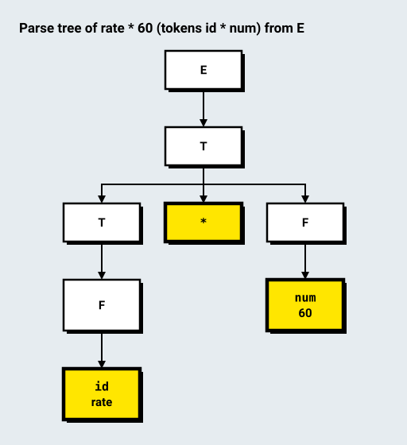

# Chapter 5: Grammars ready for parsing

<!-- contents -->
- [5.1 Context-free grammars, derivations and parse trees](#51-context-free-grammars-derivations-and-parse-trees)
- [5.2 Ambiguity, and how precedence and associativity remove it](#52-ambiguity-and-how-precedence-and-associativity-remove-it)
- [5.3 Eliminating left recursion, by hand and in C](#53-eliminating-left-recursion-by-hand-and-in-c)
- [5.4 Left factoring, by hand and in C](#54-left-factoring-by-hand-and-in-c)
- [5.5 FIRST sets, by hand and in C](#55-first-sets-by-hand-and-in-c)
- [5.6 FOLLOW sets, by hand and in C](#56-follow-sets-by-hand-and-in-c)
- [5.7 Practice: transform and compute for exam grammars](#57-practice-transform-and-compute-for-exam-grammars)
<!-- /contents -->

## 5.1 Context-free grammars, derivations and parse trees

### What the scanner cannot see

Two promises are waiting for this chapter. At the end of section 3.1 you tried to write a regular expression for balanced parentheses and could not: the star repeats, but it cannot count, so no expression makes the number of `)` equal the number of `(`. And in section 1.2 the parser turned the token row of `pos = init + rate * 60;` into a tree in which `*` sits below `+`, and the text said the parser knew "multiply before you add" from a grammar, `E -> E + T | T`, `T -> T * F | F`, `F -> ( E ) | id`, without saying how.

Both are the same gap. Statements and expressions nest: an expression can hold a parenthesised expression, which can hold another, to any depth. The scanner station of the assembly line deals only in what is regular, so the parser station needs a stronger notation, one that can say "an expression is made of smaller expressions". That notation is the context-free grammar. The written paper asks for it in a fixed form ("give a leftmost and a rightmost derivation of `id + id * id` and draw the parse tree"), and every parser in chapters 6 to 8 is driven by one, so this section makes it exact and gives you a C program, `derive`, that does derivations for you and draws the tree, so you can check your hand work.

### A form with blanks

Think of a printed form: "Statement: `id` = ______ ;". The blank has a label, *expression*, and somewhere else in the pack there are sheets that say what may go in a blank labelled *expression*: "______ + ______", with blanks labelled *expression* and *term*, or just one blank labelled *term*. Filling in a statement means choosing a sheet for each blank, again and again, until no blanks are left and the form reads `id = id + id * num ;`.

That is the whole mechanism: labelled blanks, and sheets that say what may replace each label. The picture is right that a blank is filled the same way wherever it stands; the sheet for *expression* does not care whether the blank sits after `=` or inside parentheses. That is what "context-free" means. It stops being true in two places. A real form never puts a blank of the same label inside itself, and a grammar does it all the time: the sheet for *expression* contains a blank labelled *expression*. That self-reference is exactly the power regular expressions lacked. And on paper you would fill the blanks in whatever order you liked without noticing; here the order you choose has a name and the exam asks for a particular one.

### The four parts of a grammar

<!-- teaches: cfg = context-free grammar, production -->
A *context-free grammar* (CFG) has four parts:

1. **Terminals**: the symbols that appear in the finished sentence. For a parser these are token names from section 1.3: `id`, `num`, `=`, `+`, `*`, `(`, `)`, `;`. Never lexemes: the grammar says `id`, never `pos`.
2. **Nonterminals**: the labels of the blanks, names for kinds of phrase such as `E` (expression), `T` (term), `F` (factor), `S` (statement).
3. **A start symbol**: the one nonterminal that every sentence is built from. By convention it is the left side of the first production written.
4. **Productions**: rules of the form `A -> α`, read "A can be replaced by α", where `A` is one nonterminal and `α` is a string of terminals and nonterminals, possibly empty. The empty string is written ε.

Several productions with the same left side are written on one line, separated by `|`, which reads "or". So `E -> E + T | T` is two productions, `E -> E + T` and `E -> T`; each is called an *alternative* of `E`.

The grammar for the running statement adds one production for the statement and one for numbers to the classic expression grammar:

```text
S -> id = E ;
E -> E + T | T
T -> T * F | F
F -> ( E ) | id | num
```

Terminals: `id = ; + * ( ) num`. Nonterminals: `S E T F`. Start symbol: `S`. Productions: eight, one per alternative. The Dragon book's habits, which the exam paper uses too, tell you which is which without a list: capital letters near the start of the alphabet and words in italics are nonterminals; lower-case names, operators and punctuation are terminals; Greek letters such as α, β, γ stand for strings of either kind; `X`, `Y`, `Z` for one symbol of either kind.

In grammar terms, "context-free" means the left side of every production is a single nonterminal standing alone. Grammars whose rules look at the surroundings exist (rules like `a B c -> a x c`), but no programming language is parsed with them; checks that need the surroundings, such as "this name was declared", are left to the semantic analyzer.

Here is the balanced-parentheses language that section 3.1 could not describe, in one line:

```text
P -> ( P ) P | ε
```

A balanced string is either empty, or an `(`, a balanced string, a matching `)`, and another balanced string. The `P` inside the parentheses is the self-reference. Each use of the first alternative adds exactly one `(` and one `)`, so they always come out equal, however deep the nesting goes.

### Derivations: filling the blanks one at a time

<!-- teaches: derivation = derivation, leftmost derivation -->
A *derivation* starts from the start symbol and applies one production at a time: pick a nonterminal in the current string and replace it by the right side of one of its productions. One step is written `⇒` (in plain text, `=>`). For the statement:

```text
S => id = E ;
  => id = E + T ;
  => id = T + T ;
  => ...
```

Each string along the way is a *sentential form*. A sentential form with no nonterminals left is a *sentence*, and the set of all sentences a grammar can derive is its *language*, L(G). `α ⇒* β` means "β can be derived from α in zero or more steps", and `α ⇒+ β` "in one or more". So `S ⇒* id = id + id * num ;` says that the token row of the running statement is in the language: it is a syntactically correct statement.

At each step there may be several nonterminals to choose from. In `id = E + T ;` you could replace `E` or `T`. Two fixed choices have names, because the parsers of the next two chapters follow them:

- A *leftmost derivation* always replaces the leftmost nonterminal. Written `⇒lm`. Top-down parsers (chapter 6) build this one.
- A *rightmost derivation* always replaces the rightmost nonterminal. Written `⇒rm`. Bottom-up parsers (chapter 7) build this one, in reverse.

Here is the leftmost derivation of the running statement, every step:

| Step | Sentential form | Production used |
|---|---|---|
| | `S` | |
| 1 | `id = E ;` | `S -> id = E ;` |
| 2 | `id = E + T ;` | `E -> E + T` |
| 3 | `id = T + T ;` | `E -> T` |
| 4 | `id = F + T ;` | `T -> F` |
| 5 | `id = id + T ;` | `F -> id` |
| 6 | `id = id + T * F ;` | `T -> T * F` |
| 7 | `id = id + F * F ;` | `T -> F` |
| 8 | `id = id + id * F ;` | `F -> id` |
| 9 | `id = id + id * num ;` | `F -> num` |

Look at step 2. Why `E -> E + T` and not `E -> T`? Because the sentence has a `+` at the top level, and the only production that makes a `+` is `E -> E + T`. When you do this by hand, you look ahead at the sentence to decide; making that decision mechanically, with one token of lookahead, is the subject of chapter 6. Now the rightmost derivation of the same sentence:

| Step | Sentential form | Production used |
|---|---|---|
| | `S` | |
| 1 | `id = E ;` | `S -> id = E ;` |
| 2 | `id = E + T ;` | `E -> E + T` |
| 3 | `id = E + T * F ;` | `T -> T * F` |
| 4 | `id = E + T * num ;` | `F -> num` |
| 5 | `id = E + F * num ;` | `T -> F` |
| 6 | `id = E + id * num ;` | `F -> id` |
| 7 | `id = T + id * num ;` | `E -> T` |
| 8 | `id = F + id * num ;` | `T -> F` |
| 9 | `id = id + id * num ;` | `F -> id` |

The same nine productions, in a different order. That is not a coincidence, and the parse tree shows why.

### The parse tree: the derivation without the order

<!-- teaches: parse-tree = parse tree -->
A *parse tree* draws a derivation as a tree. The root is the start symbol. Each time a production `A -> X Y Z` is applied, the node for that `A` gets children `X`, `Y`, `Z`, from left to right. An ε-production gives its node one child, a leaf labelled ε. When the derivation is finished, every interior node is a nonterminal, every leaf is a terminal (or ε), and reading the leaves from left to right gives the sentence; that string is the tree's *yield*.

Here is the parse tree for the part of the running statement after the `+`, `rate * 60`, which scans to `id * num`:

<!-- fig: id=rate-tree
title: Parse tree of rate * 60 (tokens id * num) from E
kind: tree
dir: down
box e: E
box t1: T
box t2: T
box star: `*`
box f1: F
box f2: F
box id: `id`\nrate
box num: `num`\n60
e -> t1
t1 -> t2
t1 -> star
t1 -> f2
t2 -> f1
f1 -> id
f2 -> num
hot: id star num
-->


*Figure 5.1a: The parse tree of `rate * 60` (tokens `id * num`) from `E`. The three leaves, the sentence, are highlighted.*

The node `E` has one child `T` because `E -> T` was used there. That `T` has three children because `T -> T * F` was used. The leaves `id`, `*`, `num`, read across, are the sentence. Compare it with the tree in section 1.2: that was a *syntax tree*, with operators as interior nodes and nothing else. A parse tree keeps every nonterminal and every terminal, which makes it bigger, and makes it exactly a record of the grammar's rules. Chapter 9 attaches meaning to the nodes of parse trees; the paper asks for both kinds of tree and marks you down for mixing them.

Now the reason the leftmost and rightmost derivations used the same productions. A tree records *which* production was applied to *which* nonterminal, and forgets the order in which the nonterminals were expanded. Walk the tree top-down, always expanding the leftmost unexpanded nonterminal, and you get the leftmost derivation; always the rightmost, and you get the rightmost derivation. So one parse tree corresponds to exactly one leftmost derivation and exactly one rightmost derivation. That one-to-one link is what section 5.2 relies on: to show a sentence has two trees, it is enough to show two different leftmost derivations.

### A program that derives and draws

Doing derivations by hand is where marks are lost: a step skipped, a production applied to the wrong nonterminal, a tree that does not match the derivation. A program can do the bookkeeping. You tell it the grammar and the productions in order, by number; it applies each one to the leftmost (or rightmost) nonterminal, refuses a step that does not fit, prints each sentential form, and prints the parse tree it built along the way.

Every program in this chapter reads grammars, so the reading lives in one header, `grammar.h`, which they all include. It reads a grammar written the way you write one in the exam, one nonterminal per line, with symbols separated by blanks so that a symbol can be a word like `id` or carry a prime like `E'`. ε is typed `eps`, as `thompson` did in chapter 3.

Make the chapter's folder. Open a terminal in your home folder:

<!-- code: id=ch5-setup -->
```console
$ mkdir cdlab/ch5
$ cd cdlab/ch5
$ cat > stmt.g <<'END'
S -> id = E ;
E -> E + T | T
T -> T * F | F
F -> ( E ) | id | num
END
```

Save the header as `grammar.h`:

<!-- code: id=grammar-h mode=fragment file=grammar.h -->
```c
/* grammar.h: read a context-free grammar, keep it, build a new one,
   print it. Used by derive, leftrec, leftfac, first and follow.
   Input, one nonterminal per line:   A -> X Y Z | X | eps
   Symbols are separated by blanks; eps is the empty string. A
   nonterminal may have several lines. Every symbol that appears on a
   left side is a nonterminal; the first left side is the start symbol. */
#include <stdio.h>
#include <stdlib.h>
#include <string.h>
#include <stdarg.h>

#define MAXSYM 64              /* different symbols, eps and $ included */
#define MAXP   100             /* productions: one per alternative */
#define MAXR   12              /* symbols on one right side */
#define MAXLEN 16              /* characters in a symbol's name, plus 1 */
#define EPS    0               /* symbol 0 is eps */
#define END    1               /* symbol 1 is $, the end marker */

char name[MAXSYM][MAXLEN] = { "eps", "$" };
int  nsym = 2;                 /* symbols so far */
int  isnt[MAXSYM];             /* isnt[s] is 1 when s is a nonterminal */
int  ntorder[MAXSYM], nnt;     /* the nonterminals, in printing order */

/* production p is  lhs[p] -> rhs[p][0] ... rhs[p][len[p]-1] */
int  lhs[MAXP], len[MAXP], rhs[MAXP][MAXR], np;

/* a new grammar is built here with put(), then install() makes it current */
int  nlhs[MAXP], nlen[MAXP], nrhs[MAXP][MAXR], nnp;

const char *prog = "grammar";  /* each program puts its own name here */

void die(const char *fmt, ...)
{
    va_list ap;

    fprintf(stderr, "%s: ", prog);
    va_start(ap, fmt);
    vfprintf(stderr, fmt, ap);
    va_end(ap);
    fprintf(stderr, "\n");
    exit(1);
}

int symbol(const char *s)      /* the number of symbol s, new if unseen */
{
    int i;

    for (i = 0; i < nsym; i++)
        if (strcmp(name[i], s) == 0)
            return i;
    if (nsym == MAXSYM)
        die("more than %d symbols", MAXSYM);
    if (strlen(s) >= MAXLEN)
        die("symbol name too long: %s", s);
    strcpy(name[nsym], s);
    return nsym++;
}

void makent(int a, int pos)    /* a is a nonterminal, at place pos */
{
    int k;

    isnt[a] = 1;
    for (k = nnt; k > pos; k--)
        ntorder[k] = ntorder[k - 1];
    ntorder[pos] = a;
    nnt++;
}

/* add  a -> r1 r2  to the grammar being built */
void put(int a, const int *r1, int n1, const int *r2, int n2)
{
    if (nnp == MAXP)
        die("more than %d productions", MAXP);
    if (n1 + n2 > MAXR)
        die("a right side of %s is too long", name[a]);
    nlhs[nnp] = a;
    if (n1 > 0)
        memcpy(nrhs[nnp], r1, n1 * sizeof r1[0]);
    if (n2 > 0)
        memcpy(nrhs[nnp] + n1, r2, n2 * sizeof r2[0]);
    nlen[nnp++] = n1 + n2;
}

void install(void)             /* the grammar built becomes the grammar */
{
    memcpy(lhs, nlhs, sizeof lhs);
    memcpy(len, nlen, sizeof len);
    memcpy(rhs, nrhs, sizeof rhs);
    np = nnp;
    nnp = 0;
}

void readgrammar(void)         /* from standard input */
{
    char line[512], *tok;
    int a, r[MAXR], n, any, lineno = 0;

    while (fgets(line, sizeof line, stdin) != NULL) {
        lineno++;
        tok = strtok(line, " \t\r\n");
        if (tok == NULL)
            continue;                       /* a blank line */
        a = symbol(tok);
        tok = strtok(NULL, " \t\r\n");
        if (a == EPS || a == END || tok == NULL || strcmp(tok, "->") != 0)
            die("line %d: expected a nonterminal and ->", lineno);
        if (!isnt[a])
            makent(a, nnt);
        n = any = 0;
        do {
            tok = strtok(NULL, " \t\r\n");
            if (tok == NULL || strcmp(tok, "|") == 0) {
                if (!any)
                    die("line %d: empty alternative (write eps)", lineno);
                put(a, r, n, NULL, 0);      /* one alternative ends */
                n = any = 0;
            } else {
                any = 1;
                if (strcmp(tok, "eps") != 0) {
                    if (n == MAXR)
                        die("line %d: right side too long", lineno);
                    r[n++] = symbol(tok);
                }
            }
        } while (tok != NULL);
    }
    install();
    if (np == 0)
        die("no grammar on input");
}

char *prodtext(int p)          /* "A -> X Y Z", in a static buffer */
{
    static char buf[(MAXR + 2) * (MAXLEN + 1) + 8];
    int k;

    sprintf(buf, "%s ->", name[lhs[p]]);
    if (len[p] == 0)
        strcat(buf, " eps");
    for (k = 0; k < len[p]; k++) {
        strcat(buf, " ");
        strcat(buf, name[rhs[p][k]]);
    }
    return buf;
}

void printgrammar(void)        /* one line per nonterminal, eps last */
{
    int i, p, k, pass, bar;

    for (i = 0; i < nnt; i++) {
        printf("%s ->", name[ntorder[i]]);
        bar = 0;
        for (pass = 0; pass < 2; pass++)
            for (p = 0; p < np; p++)
                if (lhs[p] == ntorder[i] && (len[p] == 0) == pass) {
                    printf(bar ? " |" : "");
                    if (len[p] == 0)
                        printf(" eps");
                    for (k = 0; k < len[p]; k++)
                        printf(" %s", name[rhs[p][k]]);
                    bar = 1;
                }
        printf("\n");
    }
}

int primed(int a)              /* a new nonterminal A', A'', ... after a */
{
    char s[MAXLEN];
    int b, i;

    strcpy(s, name[a]);
    do {
        if (strlen(s) + 1 >= MAXLEN)
            die("no room for a prime on %s", name[a]);
        strcat(s, "'");
        for (b = 0; b < nsym && strcmp(name[b], s) != 0; b++)
            ;
    } while (b < nsym);                     /* that name is taken */
    b = symbol(s);
    for (i = 0; ntorder[i] != a; i++)
        ;
    makent(b, i + 1);
    return b;
}
```

The header keeps symbols as numbers. `name[s]` is the text of symbol `s`, and `symbol("id")` gives the number of `id`, adding it the first time it is seen. Numbers 0 and 1 are reserved for `eps` and `$`, which sections 5.5 and 5.6 need. A production is three things side by side: `lhs[p]`, the number of its left side; `len[p]`, how many symbols are on its right; and `rhs[p][0]` to `rhs[p][len[p]-1]`, those symbols. An ε-production is simply one with `len[p]` equal to 0. `readgrammar` cuts each line into words with `strtok`: the first word is the left side, the second must be `->`, and every `|` (or the end of the line) closes one alternative. `put` and `install` exist for the programs of sections 5.3 and 5.4, which build a changed grammar beside the old one and then swap it in; `primed` makes the `E'` those sections need. A header normally holds only declarations; this one holds the code as well, so each tool builds with one `gcc` command. In the lab exam you would put the same lines at the top of your one file.

Now the program. Save it as `derive.c`:

<!-- code: id=derive mode=compile -->
```c
/* derive.c: carry out a derivation and print its parse tree.
   usage: ./derive [-r] grammar-file [production numbers ...]
   With no numbers it lists the productions, numbered from 1.
   Each number rewrites the leftmost nonterminal (-r: the rightmost). */
#include "grammar.h"

#define MAXNODE 200

int nodesym[MAXNODE];          /* the symbol at each tree node */
int kids[MAXNODE][MAXR + 1], nkids[MAXNODE], nnode;
int form[MAXNODE], nform;      /* the sentential form: tree leaves */

int newnode(int s)
{
    if (nnode == MAXNODE)
        die("more than %d tree nodes", MAXNODE);
    nodesym[nnode] = s;
    nkids[nnode] = 0;
    return nnode++;
}

void printform(void)
{
    int i;

    if (nform == 0)
        printf(" eps");
    for (i = 0; i < nform; i++)
        printf(" %s", name[nodesym[form[i]]]);
}

void printtree(int v, int depth)
{
    int i;

    printf("%*s%s\n", 2 * depth, "", name[nodesym[v]]);
    for (i = 0; i < nkids[v]; i++)
        printtree(kids[v][i], depth + 1);
}

int main(int argc, char *argv[])
{
    int rightmost = 0, a = 1, i, j, k, p, v, step, left = 0;
    char *end;

    prog = "derive";
    if (argc > 1 && strcmp(argv[1], "-r") == 0) {
        rightmost = 1;
        a = 2;
    }
    if (a >= argc) {
        fprintf(stderr, "usage: derive [-r] grammar-file [numbers ...]\n");
        return 1;
    }
    if (freopen(argv[a], "r", stdin) == NULL) {
        perror(argv[a]);
        return 1;
    }
    readgrammar();
    if (a + 1 == argc) {                    /* no numbers: list them */
        for (p = 0; p < np; p++)
            printf("%2d  %s\n", p + 1, prodtext(p));
        return 0;
    }

    form[0] = newnode(ntorder[0]);          /* start with the start symbol */
    nform = 1;
    printf("    ");
    printform();
    printf("\n");
    for (i = a + 1, step = 1; i < argc; i++, step++) {
        p = (int) strtol(argv[i], &end, 10) - 1;
        if (*end != '\0' || p < 0 || p >= np)
            die("step %d: there is no production %s", step, argv[i]);
        k = -1;                             /* the nonterminal to rewrite */
        for (j = 0; j < nform; j++)
            if (isnt[nodesym[form[j]]]) {
                k = j;
                if (!rightmost)
                    break;                  /* leftmost: the first found */
            }
        if (k < 0)
            die("step %d: no nonterminal left to rewrite", step);
        v = form[k];
        if (nodesym[v] != lhs[p])
            die("step %d: production %d rewrites %s, but the %s "
                "nonterminal is %s", step, p + 1, name[lhs[p]],
                rightmost ? "rightmost" : "leftmost", name[nodesym[v]]);
        if (nform + len[p] > MAXNODE)
            die("sentential form too long");

        /* the node gets one child per symbol (eps: one eps leaf) ... */
        if (len[p] == 0)
            kids[v][nkids[v]++] = newnode(EPS);
        for (j = 0; j < len[p]; j++)
            kids[v][nkids[v]++] = newnode(rhs[p][j]);
        /* ... and in the sentential form its children take its place */
        memmove(form + k + len[p], form + k + 1,
                (nform - k - 1) * sizeof form[0]);
        for (j = 0; j < len[p]; j++)
            form[k + j] = kids[v][j];
        nform += len[p] - 1;

        printf("=>%s", rightmost ? "rm" : "lm");
        printform();
        printf("   [%d]\n", p + 1);
    }
    for (j = 0; j < nform; j++)
        if (isnt[nodesym[form[j]]])
            left = 1;
    if (left)
        printf("(not a sentence yet: nonterminals are left)\n");
    printf("parse tree:\n");
    printtree(0, 0);
    return 0;
}
```

The program keeps two things in step. The tree is an array of nodes: node `v` holds a symbol, `nodesym[v]`, and the numbers of its children, `kids[v][0]`, `kids[v][1]`, and so on. The sentential form is not stored as a string at all: it is the list of the tree's current leaves, left to right, in `form[]`. A step finds position `k` of the leftmost nonterminal leaf (or, with `-r`, keeps searching to the last one), checks that the production asked for really has that nonterminal on its left, hangs new child nodes under it, and then puts those children into `form[]` in its place with one `memmove`. For an ε-production the node gets an `eps` leaf in the tree, but nothing goes into the form, so the form gets one symbol shorter. Printing the tree is a recursive walk, each level indented two spaces more than its parent.

Build it, list the productions, and give it the leftmost derivation from the table, production by production:

<!-- code: id=derive-lm -->
```console
$ gcc -Wall -Wextra derive.c -o derive
$ ./derive stmt.g
 1  S -> id = E ;
 2  E -> E + T
 3  E -> T
 4  T -> T * F
 5  T -> F
 6  F -> ( E )
 7  F -> id
 8  F -> num
$ ./derive stmt.g 1 2 3 5 7 4 5 7 8
     S
=>lm id = E ;   [1]
=>lm id = E + T ;   [2]
=>lm id = T + T ;   [3]
=>lm id = F + T ;   [5]
=>lm id = id + T ;   [7]
=>lm id = id + T * F ;   [4]
=>lm id = id + F * F ;   [5]
=>lm id = id + id * F ;   [7]
=>lm id = id + id * num ;   [8]
parse tree:
S
  id
  =
  E
    E
      T
        F
          id
    +
    T
      T
        F
          id
      *
      F
        num
  ;
```

### Reading the output

The listing numbers the productions in the order they appear in the file, one per alternative, from 1 to 8. The derivation is the hand table, line for line, with the production number on the right of each step. Then the tree, one node per line, children indented under their parent. Read the leaves (the lines that have nothing indented under them): `id`, `=`, `id`, `+`, `id`, `*`, `num`, `;`. That is the yield, and it is the token row of `pos = init + rate * 60;`. The `T` straight after the `+`, with everything indented under it, is the `rate * 60` part: the shape Figure 5.1a draws, there hanging from an `E` of its own.

Find the `*` in the tree. It is a child of a `T` that is itself the right child of the `E` that holds the `+`. To work out that `E`, you need the value of the `T` first, so the multiplication happens before the addition. That is section 1.2's rule "multiply before you add", and you can now see where it comes from: `*` is made only by `T`, `+` only by `E`, and `T` sits under `E` in every tree this grammar can make. Section 5.2 shows what goes wrong when a grammar does not arrange that.

Now the rightmost derivation, from the second table:

<!-- code: id=derive-rm -->
```console
$ ./derive -r stmt.g 1 2 4 8 5 7 3 5 7
     S
=>rm id = E ;   [1]
=>rm id = E + T ;   [2]
=>rm id = E + T * F ;   [4]
=>rm id = E + T * num ;   [8]
=>rm id = E + F * num ;   [5]
=>rm id = E + id * num ;   [7]
=>rm id = T + id * num ;   [3]
=>rm id = F + id * num ;   [5]
=>rm id = id + id * num ;   [7]
parse tree:
S
  id
  =
  E
    E
      T
        F
          id
    +
    T
      T
        F
          id
      *
      F
        num
  ;
```

Different steps, the same tree, node for node: the one-to-one link between trees and derivations, demonstrated.

### When it goes wrong

**A production applied to the wrong nonterminal.** In a leftmost derivation the choice of *which* nonterminal is not yours; only the production is. A common slip is to expand `T` while an `E` stands to its left. The program refuses, and the message names both:

<!-- code: id=derive-bad exit=1 -->
```console
$ ./derive stmt.g 1 2 4
     S
=>lm id = E ;   [1]
=>lm id = E + T ;   [2]
derive: step 3: production 4 rewrites T, but the leftmost nonterminal is E
```

At step 3 the form is `id = E + T ;`. Production 4 is `T -> T * F`, but the leftmost nonterminal is `E`. In a rightmost derivation that step would have been right; the same numbers mean different things with and without `-r`.

**Lexemes in the grammar.** Writing `F -> pos | init | rate` instead of `F -> id` gives a grammar that only knows three names. Terminals are token names. If your derivation ends in `pos = init + ...`, it has skipped the scanner.

**A tree that is really a syntax tree.** Drawing `+` as a node with `init` and `*` below it is the syntax tree of section 1.2. A parse tree for this grammar has `E`, `T` and `F` nodes, and every operator is a leaf. Check: every interior node must be a nonterminal, and its children must be exactly one right side of that nonterminal, in order.

**The ε leaf left out.** When a step uses an ε-production, the nonterminal does not vanish from the tree; it gets one child, ε. Without it, the node looks like an unexpanded nonterminal and the tree is unfinished. The program draws it as `eps`.

**Stopping early.** If the numbers run out while a nonterminal is still in the form, you have a sentential form, not a sentence. The program says so (`not a sentence yet`) and prints the partial tree, whose leaves still include that nonterminal.

### In one line each

1. A CFG is terminals (token names), nonterminals, a start symbol and productions `A -> α`.
2. A derivation rewrites one nonterminal per step; leftmost always picks the leftmost one, rightmost the rightmost.
3. The strings along the way are sentential forms; a form with only terminals is a sentence; all sentences make the language.
4. A parse tree records which production rewrote which nonterminal; its leaves, read left to right, are the yield.
5. One parse tree gives exactly one leftmost and one rightmost derivation.
6. The grammar decides the structure: `*` below `+` because `T` sits below `E`.

**Check yourself**

<!-- q: idea=derivation type=apply wrong="the leftmost derivation expands the nonterminal you like" -->
1. Using `stmt.g`, write the leftmost derivation of `id = ( id + num ) ;` as a list of production numbers. Then check it with `./derive stmt.g ...`.

<details>
<summary>Answer</summary>

`1 3 5 6 2 3 5 7 5 8`. Step by step: `S => id = E ;` (1), `=> id = T ;` (3), `=> id = F ;` (5), `=> id = ( E ) ;` (6), `=> id = ( E + T ) ;` (2), `=> id = ( T + T ) ;` (3), `=> id = ( F + T ) ;` (5), `=> id = ( id + T ) ;` (7), `=> id = ( id + F ) ;` (5), `=> id = ( id + num ) ;` (8). The parentheses force the long chain `E => T => F => ( E )` before the `+` can appear: inside parentheses you start again from `E`. A common mistake is to use production 2 first, at the top level, but there is no `+` at the top level of this sentence.

</details>

<!-- q: idea=parse-tree type=predict wrong="a different derivation order gives a different tree" -->
2. You give `derive -r stmt.g` the rightmost derivation of `id = ( id + num ) ;`. Without running it, what is the first number, and will the tree printed differ from the one in question 1?

<details>
<summary>Answer</summary>

The first number is 1 (`S -> id = E ;`), because with a single nonterminal in the form, leftmost and rightmost are the same. The tree is identical: a sentence of this grammar has one tree, and the leftmost and rightmost derivations are two orders of walking it. The full rightmost list is `1 3 5 6 2 5 8 3 5 7`.

</details>

<!-- q: idea=cfg type=fix wrong="any notation with a self-reference is a CFG" -->
3. Find the fault. A student writes this grammar for identifier lists such as `a, b, c`: `L -> L , id | id` with `L` as the start symbol, and lists the terminals as `L`, `,` and `id`. What is wrong, and what does the language contain?

<details>
<summary>Answer</summary>

`L` is a nonterminal, not a terminal: it appears on a left side. The terminals are `,` and `id`. The language is one or more `id` separated by commas: `id`, `id , id`, `id , id , id`, and so on. The productions themselves are fine; `L` refers to itself, and that is allowed and is exactly what lets the list grow.

</details>

<!-- q: idea=cfg type=apply wrong="balanced parentheses need a counter in the grammar" -->
4. Use `derive` with a grammar file holding `P -> ( P ) P | eps` to derive `( ( ) ) ( )`. Which numbers did you use, and how many `eps` leaves does the tree have?

<details>
<summary>Answer</summary>

The productions are 1 `P -> ( P ) P` and 2 `P -> eps`. Leftmost: `1 1 2 2 1 2 2`. The forms are `( P ) P`, `( ( P ) P ) P`, `( ( ) P ) P`, `( ( ) ) P`, `( ( ) ) ( P ) P`, `( ( ) ) ( ) P`, `( ( ) ) ( )`. Four uses of production 2 means four `eps` leaves in the tree; each use of production 1 brings a matching pair of parentheses and two new `P`s, so three uses give three pairs and need four `eps` leaves to finish.

</details>

## 5.2 Ambiguity, and how precedence and associativity remove it

### Why not the short grammar?

The grammar of section 5.1 has three nonterminals for expressions, `E`, `T` and `F`, and three levels of production. A shorter grammar describes exactly the same set of expressions:

```text
E -> E + E | E * E | ( E ) | id
```

It is easier to read, and every expression the long grammar accepts, this one accepts too. So why does every textbook, and section 1.2, insist on the long one? The paper asks the question directly ("show that this grammar is ambiguous", "write an unambiguous grammar for arithmetic expressions with the usual precedence and associativity"), and Yacc will ask it again in chapter 8, when it prints "conflicts" for a grammar like this one. This section answers it.

### One sentence, two meanings

Think of the sentence "I saw the man with the telescope". Every word is clear, and still it has two meanings: you used the telescope, or the man was holding it. The words do not tell you how they group. A listener picks one grouping without noticing; a machine has to be told.

`id + id * id` under the short grammar is that sentence. The picture is exact in one way: the words (tokens) are the same and only the grouping differs. It breaks in another: in English the context usually settles it, and in a compiler nothing settles it. If the grammar allows two groupings, the parser has no further information, and the two groupings compute different numbers.

### Two trees for `id + id * id`

<!-- teaches: ambiguity = ambiguous grammar, ambiguity -->
A grammar is *ambiguous* if some sentence has more than one parse tree. Because each tree has exactly one leftmost derivation (section 5.1), the same thing can be said as: some sentence has two different leftmost derivations. Or two different rightmost ones. To show that a grammar is ambiguous, you produce one sentence and two of its trees; nothing more is needed.

Put the short grammar in a file and let `derive` list it:

<!-- code: id=amb-list -->
```console
$ cat > amb.g <<'END'
E -> E + E | E * E | ( E ) | id
END
$ ./derive amb.g
 1  E -> E + E
 2  E -> E * E
 3  E -> ( E )
 4  E -> id
```

Now two leftmost derivations of `id + id * id`. The first starts with `E -> E + E` (production 1): the `+` is at the top of the tree and the multiplication is inside its right operand. The second starts with `E -> E * E` (production 2): the `*` is at the top and the addition is inside its left operand.

<!-- code: id=amb-two -->
```console
$ ./derive amb.g 1 4 2 4 4
     E
=>lm E + E   [1]
=>lm id + E   [4]
=>lm id + E * E   [2]
=>lm id + id * E   [4]
=>lm id + id * id   [4]
parse tree:
E
  E
    id
  +
  E
    E
      id
    *
    E
      id
$ ./derive amb.g 2 1 4 4 4
     E
=>lm E * E   [2]
=>lm E + E * E   [1]
=>lm id + E * E   [4]
=>lm id + id * E   [4]
=>lm id + id * id   [4]
parse tree:
E
  E
    E
      id
    +
    E
      id
  *
  E
    id
```

Both end in the same sentence, `id + id * id`, and the trees differ at the root. Compare the forms: from the third step on, both derivations print exactly the same lines, `id + E * E`, `id + id * E`, `id + id * id`. What differs is *which* `E` the `+` and the `*` belong to, and only the tree shows it. This is why the paper wants trees, not just derivations: two derivations that print the same sentential forms can still be two different trees.

The first tree groups the sentence as `id + (id * id)`, the second as `(id + id) * id`. With `init = 10`, `rate = 2.5` and the number 60 in place of the three ids, the first is 160, the answer `pos.c` printed in chapter 1. The second is 750.

### An experiment: how many meanings?

How bad is it? With a longer expression the number of trees grows quickly. The program below takes an expression of whole numbers joined by `+`, `-` and `*`, and prints every parse tree the ambiguous grammar `E -> E + E | E - E | E * E | num` allows, each written with full parentheses, together with its value. It works the way you would by hand: the operator at the root can be any one of the operators; for each choice, the left part and the right part are smaller expressions with their own sets of trees, and every left tree can be paired with every right tree. It builds the sets for short ranges of numbers first, then for longer ones.

Save it as `alltrees.c`:

<!-- code: id=alltrees mode=compile -->
```c
/* alltrees.c: every parse tree of an expression such as 2+3*4-1 under the
   ambiguous grammar E -> E + E | E - E | E * E | num, with its value. */
#include <stdio.h>
#include <stdlib.h>
#include <string.h>
#include <ctype.h>

#define MAXK 7                 /* numbers in one expression */
#define MAXT 132               /* trees of 7 numbers */

struct tree {
    char text[200];            /* the tree, written with full parentheses */
    long value;
};

struct tree t[MAXK][MAXK][MAXT];   /* t[i][j]: trees for numbers i to j */
int nt[MAXK][MAXK];
long num[MAXK];
char op[MAXK];                 /* op[m] stands between num[m] and num[m+1] */
int k;                         /* numbers in this expression */

int readexpr(char *s)          /* 1 if s is an expression; fills num, op */
{
    k = 0;
    for (;;) {
        while (*s == ' ')
            s++;
        if (!isdigit((unsigned char) *s) || k == MAXK)
            return 0;
        num[k++] = strtol(s, &s, 10);
        while (*s == ' ')
            s++;
        if (*s == '\n' || *s == '\0')
            return 1;
        if (*s != '+' && *s != '-' && *s != '*')
            return 0;
        op[k - 1] = *s++;
    }
}

void build(void)
{
    int n, i, j, m, a, b;
    struct tree *l, *r, *x;
    char buf[2 * sizeof t[0][0][0].text + 8];

    for (i = 0; i < k; i++) {               /* one number: one tree */
        snprintf(t[i][i][0].text, sizeof t[i][i][0].text, "%ld", num[i]);
        t[i][i][0].value = num[i];
        nt[i][i] = 1;
    }
    for (n = 2; n <= k; n++)                /* n numbers, short first */
        for (i = 0; i + n - 1 < k; i++) {
            j = i + n - 1;
            nt[i][j] = 0;
            for (m = i; m < j; m++)         /* op[m] at the root */
                for (a = 0; a < nt[i][m]; a++)
                    for (b = 0; b < nt[m + 1][j]; b++) {
                        l = &t[i][m][a];
                        r = &t[m + 1][j][b];
                        x = &t[i][j][nt[i][j]++];
                        if (snprintf(buf, sizeof buf, "(%s %c %s)",
                                     l->text, op[m], r->text)
                            >= (int) sizeof x->text) {
                            fprintf(stderr, "alltrees: numbers too long\n");
                            exit(1);
                        }
                        strcpy(x->text, buf);
                        x->value = op[m] == '+' ? l->value + r->value
                                 : op[m] == '-' ? l->value - r->value
                                 : l->value * r->value;
                    }
        }
}

int main(void)
{
    char line[256];
    int i, n;

    while (fgets(line, sizeof line, stdin) != NULL) {
        if (!readexpr(line)) {
            fprintf(stderr, "alltrees: not 1 to %d numbers joined by + - *: %s",
                    MAXK, line);
            return 1;
        }
        build();
        n = nt[0][k - 1];
        for (i = 0; i < n; i++)
            printf("%s = %ld\n", t[0][k - 1][i].text, t[0][k - 1][i].value);
        printf("%d tree%s\n\n", n, n == 1 ? "" : "s");
    }
    return 0;
}
```

Build it and give it three expressions, then ask the shell, which follows C's rules, for the one answer each should have:

<!-- code: id=alltrees-run -->
```console
$ gcc -Wall -Wextra alltrees.c -o alltrees
$ printf '2+3*4\n10-4-3\n2+3*4-1\n' | ./alltrees
(2 + (3 * 4)) = 14
((2 + 3) * 4) = 20
2 trees

(10 - (4 - 3)) = 9
((10 - 4) - 3) = 3
2 trees

(2 + (3 * (4 - 1))) = 11
(2 + ((3 * 4) - 1)) = 13
((2 + 3) * (4 - 1)) = 15
((2 + (3 * 4)) - 1) = 13
(((2 + 3) * 4) - 1) = 19
5 trees
$ echo $((2+3*4)) $((10-4-3)) $((2+3*4-1))
14 3 13
```

Read the three blocks against the shell's answers.

`2+3*4` has two trees, one for each choice of root. The shell says 14, which is the tree with `+` at the root: multiplication done first. That is *precedence*, the same word section 3.1 used for the order of `|`, concatenation and `*`: here `*` binds tighter than `+`.

`10-4-3` has two trees too, and here both operators are the same. `((10 - 4) - 3)` is 3; `(10 - (4 - 3))` is 9. The shell says 3: of two equal operators, the left one is done first. That is *associativity*: `-` is left-associative. Ambiguity is not only about mixing operators; a single operator used twice is enough.

`2+3*4-1` has five trees with four different values. Only one tree has the meaning C gives it. (Two trees happen to give 13; the right one is the one with `-` at the root and `+` directly under it, `((2 + (3 * 4)) - 1)`.) And it gets worse with length:

<!-- code: id=alltrees-count -->
```console
$ printf '1+1+1+1+1+1\n' | ./alltrees | tail -2
42 trees
```

Six numbers, 42 trees. The counts for 1, 2, 3, 4, 5, 6 numbers are 1, 1, 2, 5, 14, 42: each count is, added up over every choice of root, the trees on the left times the trees on the right. A parser for the short grammar would have to pick one of these 42 by some rule the grammar does not contain.

### Removing ambiguity: one nonterminal per level

<!-- teaches: precedence-grammar = associativity, unambiguous expression grammar, dangling else -->
The cure is to write the precedence and the associativity into the grammar itself, so that only the right tree can be built. Two rules do it.

**Precedence: one nonterminal per level, lowest level at the top.** Give each precedence level its own nonterminal. The lowest-precedence operator (`+`, `-`) is produced by the nonterminal nearest the start symbol (`E`); the next (`*`, `/`) by the next one down (`T`); and the things that bind tightest of all, single operands and parenthesised expressions, by the bottom one (`F`). A `T` can only be built out of `F`s and `*`; it can never contain a bare `+`. So in any tree, every `*` sits below every `+` that shares an expression with it, which is exactly "multiply first". Parentheses get around it on purpose: `F -> ( E )` climbs back to the top level inside the parentheses.

**Associativity: the side of the recursion.** Within one level, the production for a left-associative operator recurses on the *left*: `E -> E + T`. The `E` on the left can grow into another `E + T`, so a chain `a - b - c` must be built as `(a - b) - c`: the tree leans to the left, and the leftmost operator is deepest, done first. The right operand is a `T`, which cannot contain a bare `-`, so there is no other way to build it. A right-associative operator recurses on the *right* instead. Exponentiation, written `^`, is the classic one: `2 ^ 3 ^ 2` means `2 ^ (3 ^ 2)`, which is 512, not `(2 ^ 3) ^ 2` = 64.

Put together, for `+ - * /` and a right-associative `^` that binds tighter than both:

```text
E -> E + T | E - T | T
T -> T * F | T / F | F
F -> P ^ F | P
P -> ( E ) | id
```

Read it from the top. An expression is a sum of terms, left-associative. A term is a product of factors, left-associative. A factor is a power: a primary, optionally followed by `^` and another factor, which makes it right-associative. A primary is an identifier or a parenthesised expression. One level per row of the precedence table, lowest first; the side of the recursion gives each row its associativity.

Check the claim on the sentence that broke the short grammar. In `expr.g`, the classic grammar, `id + id * id` has one leftmost derivation:

<!-- code: id=expr-one -->
```console
$ cat > expr.g <<'END'
E -> E + T | T
T -> T * F | F
F -> ( E ) | id
END
$ ./derive expr.g 1 2 4 6 3 4 6 6
     E
=>lm E + T   [1]
=>lm T + T   [2]
=>lm F + T   [4]
=>lm id + T   [6]
=>lm id + T * F   [3]
=>lm id + F * F   [4]
=>lm id + id * F   [6]
=>lm id + id * id   [6]
parse tree:
E
  E
    T
      F
        id
  +
  T
    T
      F
        id
    *
    F
      id
```

Try to build the other grouping. To put `*` at the root you would need the first step to make a `*`, but `E` cannot make a `*` directly; it must go through `E -> T` and then `T -> T * F`, and then everything to the left of that `*`, which is `id + id`, would have to come from the `T`. A `T` cannot produce a bare `+`. So the second tree does not exist. That argument, "this nonterminal cannot produce that operator outside parentheses", is the argument the paper expects when it asks why the grammar is unambiguous.

Notice what the cure cost. The grammar went from one nonterminal to three (four with `^`), and the trees got taller: `id` alone is now `E => T => F => id`, three steps where the short grammar took one. Every one of those chain steps is work for a parser. That is one reason chapter 8 shows a second cure: keep the short, ambiguous grammar and tell the parser generator the precedence and associativity separately (`%left '+' '-'`, `%left '*' '/'`), so that it chooses the right tree whenever the grammar offers two. Both cures appear in the paper; the grammar rewrite is the one you do by hand.

One more fact worth knowing: there is no general algorithm that decides, for every grammar, whether it is ambiguous. For a given grammar you prove ambiguity with one example; you argue unambiguity with reasoning like the one above. Testing a thousand sentences proves nothing.
<!-- checked: how=known date=2026-11-21 ref="ambiguity of CFGs is undecidable: Cantor 1962, Floyd 1962, Chomsky-Schutzenberger 1963; Hopcroft-Ullman" h=b2e75b8c -->

### The dangling else

The second classic ambiguity is in statements, not expressions. Take a grammar with `if` and an optional `else`:

```text
stmt -> if expr then stmt | if expr then stmt else stmt | other
```

The Dragon book abbreviates it, and section 5.4 uses the short form: `i` for `if expr then`'s `if`, `E` with `E -> b` for the condition, `t` for `then`, `e` for `else`, `a` for `other`:

```text
S -> i E t S | i E t S e S | a
E -> b
```

Now take `if b then if b then a else a`, which is `i b t i b t a e a`. Which `if` does the `else` belong to? Both readings are trees of this grammar:

<!-- code: id=dangle-two -->
```console
$ cat > dangle.g <<'END'
S -> i E t S | i E t S e S | a
E -> b
END
$ ./derive dangle.g 1 4 2 4 3 3
     S
=>lm i E t S   [1]
=>lm i b t S   [4]
=>lm i b t i E t S e S   [2]
=>lm i b t i b t S e S   [4]
=>lm i b t i b t a e S   [3]
=>lm i b t i b t a e a   [3]
parse tree:
S
  i
  E
    b
  t
  S
    i
    E
      b
    t
    S
      a
    e
    S
      a
$ ./derive dangle.g 2 4 1 4 3 3
     S
=>lm i E t S e S   [2]
=>lm i b t S e S   [4]
=>lm i b t i E t S e S   [1]
=>lm i b t i b t S e S   [4]
=>lm i b t i b t a e S   [3]
=>lm i b t i b t a e a   [3]
parse tree:
S
  i
  E
    b
  t
  S
    i
    E
      b
    t
    S
      a
  e
  S
    a
```

In the first tree the outer `S` used production 1, with no `else`, and the inner `if` took the `else` (production 2): the `else` matches the nearest `then`. In the second the outer `S` took the `else` and the inner `if` has none. C, Java, Pascal and every language you will meet in the paper choose the first reading: *an `else` matches the nearest unmatched `then`*.
<!-- checked: how=known date=2026-11-21 ref="C11 6.8.4.1p3 (else to lexically nearest if); JLS 14.5 StatementNoShortIf; ISO 7185 Pascal; Dragon 2nd ed. 4.3.2" h=40373e6e -->

Removing this ambiguity uses the same idea as precedence: split one nonterminal into two kinds that cannot be confused. A *matched* statement has an `else` for every `then` inside it; an *open* statement has at least one `then` without an `else`. Between a `then` and its `else` only a matched statement may stand:

```text
stmt         -> matched_stmt | open_stmt
matched_stmt -> if expr then matched_stmt else matched_stmt | other
open_stmt    -> if expr then stmt | if expr then matched_stmt else open_stmt
```

In the second tree above, the inner statement between the outer `then` and the `else` is `if b then a`, which has a `then` and no `else`: it is open, and the grammar forbids an open statement there. So only the first tree can be built. This grammar is the one the Dragon book gives; it is correct and almost never used in practice, because it doubles the statement rules. Real parsers keep the short grammar and resolve the choice inside the parser: Yacc does it by preferring to shift the `else` (section 7.6), and a recursive-descent parser does it by taking the `else` whenever it sees one.

### When it goes wrong

**Showing two derivations of one tree.** A student "proves" `expr.g` ambiguous with a leftmost and a rightmost derivation of `id + id * id`. Those are the same tree walked in two orders (section 5.1). Ambiguity needs two leftmost derivations, or two rightmost ones, or two trees. Draw both trees: if they are the same, you have proved nothing.

**Recursion on the wrong side.** `E -> T + E | T` describes exactly the same strings as `E -> E + T | T` and is unambiguous, but it groups `a - b - c` as `a - (b - c)` once `-` is added. The grammar is fine as a recogniser and wrong as a translator: anything that computes from the tree, such as the calculator of chapter 8 or the code generator of chapter 9, will print 9 for `10 - 4 - 3`. Section 5.3 needs this point: the recursion on the left in `E -> E + T` is there for a reason, and removing it must not change the grouping.

**Levels in the wrong order.** Putting `+` below `*` (`E -> E * T | T`, `T -> T + F | F`) gives an unambiguous grammar in which `2 + 3 * 4` is 20. The rule: the operator that binds most loosely is closest to the start symbol.

**An operator added at the wrong level.** Unary minus added as `E -> - E` makes `- a + b` ambiguous again (`-(a + b)` or `(-a) + b`). An operator belongs on exactly one level; unary minus usually goes at the bottom, `F -> - F`.

### In one line each

1. A grammar is ambiguous when one sentence has two parse trees, or equivalently two leftmost derivations.
2. One example sentence with two trees proves ambiguity; no test of examples proves the opposite.
3. Ambiguity matters because different trees compute different values: `2+3*4` gives 14 or 20.
4. Precedence: one nonterminal per level, the loosest operator nearest the start symbol.
5. Associativity: recursion on the left for left-associative operators, on the right for right-associative ones.
6. The dangling else: an `else` matches the nearest unmatched `then`; the grammar fix splits statements into matched and open.

**Check yourself**

<!-- q: idea=ambiguity type=apply wrong="a single operator can't make a grammar ambiguous" -->
1. Show that `S -> S S | a` is ambiguous. Give the shortest sentence that has two trees and two leftmost derivations of it as production numbers for `derive`.

<details>
<summary>Answer</summary>

`a a a`. The productions are 1 `S -> S S` and 2 `S -> a`. Leftmost derivation `1 1 2 2 2`: `S S`, `S S S` (the left `S` split), `a S S`, `a a S`, `a a a`: grouped `(a a) a`. Leftmost derivation `1 2 1 2 2`: `S S`, `a S`, `a S S`, `a a S`, `a a a`: grouped `a (a a)`. Same sentence, different trees. `a a` has only one tree, so it cannot show ambiguity; it is the third `a` that gives a choice of where to split, exactly like `10-4-3`.

</details>

<!-- q: idea=precedence-grammar type=predict wrong="right recursion and left recursion give the same values" -->
2. A grammar for subtraction is written `E -> T - E | T`, `T -> num`. Predict the value its parse tree gives to `10 - 4 - 3`, and say what one change makes it agree with C.

<details>
<summary>Answer</summary>

9. The recursion is on the right, so the only tree is `10 - (4 - 3)`: the `E` after the first `-` must produce `4 - 3`. The language is right and the grammar is unambiguous, but the grouping is right-associative. Change the first production to `E -> E - T`; then the only tree is `(10 - 4) - 3`, which is 3, the shell's answer.

</details>

<!-- q: idea=precedence-grammar type=apply wrong="add a new operator as another alternative of E" -->
3. Add a remainder operator `%` with the same precedence and associativity as `*` and `/`, and a unary minus that binds tighter than `*`, to the four-level grammar in this section. Write the new grammar.

<details>
<summary>Answer</summary>

```text
E -> E + T | E - T | T
T -> T * F | T / F | T % F | F
F -> P ^ F | P
P -> ( E ) | - P | id
```

`%` joins `T`, the level of `*` and `/`, recursing on the left like them. Unary minus goes at the bottom, as `P -> - P`, so it applies to one primary: `- a * b` is `(- a) * b`. Whether `- a ^ 2` should mean `-(a ^ 2)` is a language decision; with this grammar it means `(- a) ^ 2`, and to get the other reading you would put the minus at the `F` level, above `^`.

</details>

<!-- q: idea=ambiguity type=fix wrong="a leftmost and a rightmost derivation prove ambiguity" -->
4. Find the fault. To prove that `dangle.g` is ambiguous, a student gives the leftmost derivation `1 4 2 4 3 3` and the rightmost derivation `1 2 3 3 4 4` (run with `-r`) of `i b t i b t a e a`. Do these two derivations prove it?

<details>
<summary>Answer</summary>

No. Both start with production 1 at the root and use production 2 for the inner `S`: they are the same tree (the `else` with the inner `if`), walked leftmost and rightmost. A proof needs two different trees: the leftmost derivations `1 4 2 4 3 3` and `2 4 1 4 3 3`, whose first productions differ.

</details>

## 5.3 Eliminating left recursion, by hand and in C

### The grammar that hangs a parser

Section 5.2 ended with a grammar you can trust: `expr.g`, unambiguous, with `*` below `+` and both operators left-associative. Chapter 6 turns grammars into parsers, and the most natural way to do that is to write one C function per nonterminal, whose body follows the nonterminal's productions: for `E -> E + T`, "to read an `E`, read an `E`, then a `+`, then a `T`". Section 6.1 builds such parsers properly. Here, just try that one sentence in C and see what happens.

<!-- teaches: left-recursion = left recursion, immediate left recursion, indirect left recursion -->
A production like `E -> E + T`, whose right side begins with its own left side, is called *left-recursive*. A grammar is left-recursive if some nonterminal `A` can derive a string that begins with `A` again, `A ⇒+ A α`. When it happens in one step, as in `E -> E + T`, it is *immediate* left recursion; when it takes several (`A -> B x`, `B -> A y`), it is *indirect*.

Type this session. It saves `leftloop.c`, which is `E -> E + T` written straight into C with a counter so that you can see how far it gets, then builds it and runs it:

<!-- code: id=leftloop exit=139 varies -->
```console
$ cat > leftloop.c <<'END'
/* leftloop.c: E -> E + T | T turned straight into C. Do not do this. */
#include <stdio.h>

const char *in = "id+id";      /* the input; never read */
long calls;

void T(void)
{
}

void E(void)
{
    calls++;
    if (calls % 100000 == 0)
        fprintf(stderr, "E called %ld times, no input read yet\n", calls);
    E();                       /* E -> E + T: first read an E ... */
    if (*in == '+') {          /* ... then a +, then a T */
        in++;
        T();
    }
}

int main(void)
{
    E();
    printf("parsed\n");
    return 0;
}
END
$ gcc -Wall -Wextra leftloop.c -o leftloop
leftloop.c: In function ‘E’:
leftloop.c:11:6: warning: infinite recursion detected [-Winfinite-recursion]
   11 | void E(void)
      |      ^
leftloop.c:16:5: note: recursive call
   16 |     E();                       /* E -> E + T: first read an E ... */
      |     ^~~
$ ./leftloop
E called 100000 times, no input read yet
E called 200000 times, no input read yet
E called 300000 times, no input read yet
E called 400000 times, no input read yet
E called 500000 times, no input read yet
Segmentation fault
```

GCC sees the problem before you run anything: `-Wall` turns on a check for a function that calls itself on every path with nothing that could stop it, and `E` is exactly that. Run it anyway, and `E` calls `E`, which calls `E`, each call pushing a new frame on the stack without reading a single character, until the stack is full and the operating system kills the program. The number of calls it reaches depends on the stack size of your machine; the end is always the same.

That is the reason this section exists. The parser has one token of lookahead and must consume input to make progress. A left-recursive production asks it to start an `E` by starting an `E`, at the same position, with the same token in hand. Nothing changes between one call and the next, so nothing can end it. A bottom-up parser (chapter 7) has no trouble with left recursion, and Yacc grammars use it freely; it is the top-down parsers of chapter 6 that need it removed.

### Turning the recursion around

What does `E -> E + T | T` really say? Follow the left recursion until it stops: `E ⇒ E + T ⇒ E + T + T ⇒ T + T + T`. Every `E` is a `T` followed by any number of `+ T`. In the notation of chapter 3 that is `T (+ T)*`. The left recursion is only a way of writing "repeat `+ T`" that puts the repetition first.

The same set of strings can be produced by starting with the `T` and then generating the repetition to its right. Introduce a new nonterminal, `E'` ("the rest of an expression"), that produces zero or more `+ T`:

```text
E  -> T E'
E' -> + T E' | ε
```

`E'` is right-recursive: it makes one `+ T` and then another `E'`, or stops with ε. Now a function for `E` reads a `T` first, consuming input, and only then deals with the rest. The loop is gone.

This is the picture of a queue at a counter. Left recursion says "the queue is a queue followed by one more person": to find the start of the queue you have to keep asking about a shorter queue, forever, without looking at anyone. The rewrite says "the queue is a first person followed by the rest of the queue": you look at the first person straight away. Where the picture stops: both descriptions give the same people in the same order, but they do not give the same tree. Section 5.2's warning about the side of the recursion comes back below.

### The rule

For a nonterminal `A` with immediately left-recursive alternatives `A α1`, ..., `A αm` and other alternatives `β1`, ..., `βn` (none of which starts with `A`):

```text
A -> A α1 | A α2 | ... | A αm | β1 | β2 | ... | βn
```

becomes

```text
A  -> β1 A' | β2 A' | ... | βn A'
A' -> α1 A' | α2 A' | ... | αm A' | ε
```

In words: every non-recursive alternative of `A` gets `A'` stuck on its end; every recursive alternative loses its leading `A`, gets `A'` on its end, and moves to `A'`; and `A'` gets ε. Both grammars generate "one β, then any number of αs".

Apply it to `expr.g`, one nonterminal at a time.

`E -> E + T | T`: one recursive alternative, α1 = `+ T`; one other, β1 = `T`. So `E -> T E'` and `E' -> + T E' | ε`.

`T -> T * F | F`: α1 = `* F`, β1 = `F`. So `T -> F T'` and `T' -> * F T' | ε`.

`F -> ( E ) | id`: no alternative starts with `F`. Unchanged.

```text
E  -> T E'
E' -> + T E' | ε
T  -> F T'
T' -> * F T' | ε
F  -> ( E ) | id
```

This is the grammar of the Dragon book's predictive-parsing examples, and the one chapter 6 parses. Learn to write it in your sleep.

A case with more alternatives: `A -> A a | A b | c | d`. Two recursive ones (α1 = `a`, α2 = `b`), two others (β1 = `c`, β2 = `d`). Result: `A -> c A' | d A'`, `A' -> a A' | b A' | ε`. Both describe "a `c` or a `d`, then any mixture of `a` and `b`".

### What changed in the tree

Derive `id + id + id` in the new grammar and draw the tree. The top is `E -> T E'`; the first `id` comes from the `T`; then `E' -> + T E'` makes the first `+ id`, and *its* `E'` makes the second `+ id`, and the last `E'` goes to ε. The tree leans to the right: the second `+` sits inside the subtree of the first. Section 5.2 said that a right-leaning tree means right association, and here the tree has gone right-leaning without anyone asking for it.

The language did not change: the same sentences are accepted. What changed is the shape of the tree, so a translator that computes straight from this tree would group `10 - 4 - 3` wrongly. The grouping is not lost, only moved: in chapter 6 the parser for `E'` will pass the value computed so far *down* into the rest (an inherited attribute, section 9.1), so that `10 - 4` is worked out before `- 3` is seen. For this chapter the point is the exam one: eliminating left recursion preserves the language, not the parse trees.

### Indirect left recursion

The rule handles left recursion you can see in one production. It can hide across several:

```text
S -> A a | b
A -> A c | S d | ε
```

`A -> A c` is immediate. But `S -> A a` and `A -> S d` together give `S ⇒ A a ⇒ S d a`: `S` derives a string starting with `S`. Removing `A -> A c` alone leaves that loop in place.

The general algorithm (the Dragon book's Algorithm 4.19) puts the nonterminals in an order, A1, A2, ..., An, and makes sure that, when it is done, every production `Ai -> Aj γ` has j greater than i: a nonterminal may only start with nonterminals *later* in the order. A loop needs to come back to an earlier one, so it cannot exist. It works through the nonterminals in order:

```text
for i = 1 to n:
    for j = 1 to i - 1:
        replace every production Ai -> Aj γ by
            Ai -> δ1 γ | δ2 γ | ... | δk γ,
        where Aj -> δ1 | δ2 | ... | δk are Aj's current productions
    eliminate the immediate left recursion of Ai
```

The substitution step replaces "starts with an earlier nonterminal" by what that earlier nonterminal can start with. Because Aj has already been processed, its productions start with terminals or with later nonterminals, so after the substitution Ai starts with terminals, with later nonterminals, or with Ai itself; and the last case is immediate left recursion, which the rule then removes.
<!-- checked: how=known date=2026-11-21 ref="Dragon 2nd ed. 4.3.3: Algorithm 4.19 Eliminating left recursion (Fig. 4.11); text cites only 4.19" h=48185b39 -->

Work the example with the order S, A.

**i = 1, S.** No earlier nonterminals; `S -> A a | b` has no immediate left recursion. Unchanged.

**i = 2, A, j = 1 (S).** The production `A -> S d` starts with S. S's productions are `A a` and `b`, so `A -> S d` becomes `A -> A a d | b d`. A's productions are now `A -> A c | A a d | b d | ε`.

**i = 2, eliminate immediate left recursion of A.** Recursive: α1 = `c`, α2 = `a d`. Others: β1 = `b d`, β2 = ε. So `A -> b d A' | A'` (β2 A' is ε A', which is just `A'`) and `A' -> c A' | a d A' | ε`.

```text
S  -> A a | b
A  -> b d A' | A'
A' -> c A' | a d A' | ε
```

S still begins with A, but A now begins with `b` or with A', and A' begins with `c`, `a` or nothing. No path leads back to S at the front.

The algorithm promises a correct answer only for grammars without *cycles* (a derivation `A ⇒+ A`, as in `A -> B`, `B -> A`) and without ε-productions. This example has `A -> ε` and still comes out right, as the Dragon book notes; with ε-productions in general, check the result, because a nullable nonterminal at the front can hide left recursion that the algorithm does not see. Exam grammars are chosen so that the algorithm works.

### Eliminating left recursion in C

The lab question is "write a program to eliminate left recursion from a grammar". `leftrec.c` reads a grammar in `grammar.h`'s form, runs the general algorithm, and prints the new grammar in the same form, so its output can be the input of the next program. Save it as `leftrec.c`:

<!-- code: id=leftrec mode=compile -->
```c
/* leftrec.c: eliminate left recursion, immediate and indirect.
   Reads a grammar on standard input (grammar.h's form) and prints
   the new grammar in the same form. */
#include "grammar.h"

/* replace every  ai -> aj gamma  by  ai -> delta gamma, for each aj -> delta */
void substitute(int ai, int aj)
{
    int p, q;

    for (p = 0; p < np; p++)
        if (lhs[p] == ai && len[p] > 0 && rhs[p][0] == aj) {
            for (q = 0; q < np; q++)
                if (lhs[q] == aj)
                    put(ai, rhs[q], len[q], rhs[p] + 1, len[p] - 1);
        } else
            put(lhs[p], rhs[p], len[p], NULL, 0);    /* copied unchanged */
    install();
}

/* A -> A a1 | ... | b1 | ...   becomes
   A -> b1 A' | ...    A' -> a1 A' | ... | eps */
void immediate(int a)
{
    int p, a2, recursive = 0, others = 0;

    for (p = 0; p < np; p++)
        if (lhs[p] == a) {
            if (len[p] > 0 && rhs[p][0] == a) {
                if (len[p] == 1)
                    die("%s -> %s is a cycle", name[a], name[a]);
                recursive++;
            } else
                others++;
        }
    if (recursive == 0)
        return;
    if (others == 0)
        die("every alternative of %s starts with %s: it derives no sentence",
            name[a], name[a]);
    a2 = primed(a);
    for (p = 0; p < np; p++)
        if (lhs[p] != a)
            put(lhs[p], rhs[p], len[p], NULL, 0);
        else if (len[p] > 0 && rhs[p][0] == a)
            put(a2, rhs[p] + 1, len[p] - 1, &a2, 1);     /* A' -> alpha A' */
        else
            put(a, rhs[p], len[p], &a2, 1);              /* A -> beta A' */
    put(a2, NULL, 0, NULL, 0);                           /* A' -> eps */
    install();
}

int main(void)
{
    int order[MAXSYM], n, i, j;

    prog = "leftrec";
    readgrammar();
    n = nnt;                       /* A1 ... An: the nonterminals read */
    memcpy(order, ntorder, sizeof order);
    for (i = 0; i < n; i++) {
        for (j = 0; j < i; j++)
            substitute(order[i], order[j]);
        immediate(order[i]);
    }
    printgrammar();
    return 0;
}
```

`main` is the algorithm's two loops, word for word. The order A1 to An is the order in which the nonterminals first appear on a left side, copied into `order[]` before the loops start, because `primed` adds each new `A'` to `ntorder` and the algorithm must not process the primes. `substitute` builds a new grammar with `put`: each production of `ai` that starts with `aj` is replaced by one production per alternative of `aj`, the alternative followed by the rest of the old right side (`rhs[p] + 1`, `len[p] - 1` symbols); every other production is copied as it was. Because the replacements are put where the old production stood, the alternatives keep the order you would write them by hand. `immediate` counts the recursive and the other alternatives first, so that it can refuse two grammars the rule cannot fix, then builds the rule's two lists: β followed by `A'` stays under `A`, α followed by `A'` goes under `A'`, and one `A' -> eps` closes it. `&a2` passes the address of the one int `a2` as an array of length 1, so that `put` can append it.

Build it and run it on the expression grammar, the indirect example, an empty input, and a grammar it must refuse:

<!-- code: id=leftrec-runs exit=1 -->
```console
$ gcc -Wall -Wextra leftrec.c -o leftrec
$ ./leftrec < expr.g
E -> T E'
E' -> + T E' | eps
T -> F T'
T' -> * F T' | eps
F -> ( E ) | id
$ cat > indirect.g <<'END'
S -> A a | b
A -> A c | S d | eps
END
$ ./leftrec < indirect.g
S -> A a | b
A -> b d A' | A'
A' -> c A' | a d A' | eps
$ ./leftrec < /dev/null; echo "exit status $?"
leftrec: no grammar on input
exit status 1
$ printf 'A -> A a | A b\n' | ./leftrec
leftrec: every alternative of A starts with A: it derives no sentence
```

Both answers are the hand answers, symbol for symbol, with `eps` printed last in each line as the hand answers write ε. The empty input and the last grammar are refused with a reason. `A -> A a | A b` has no β at all: every way of starting an `A` starts with another `A`, so no sentence can ever be derived from it, and the rule would produce an `A` with no productions. The program says so rather than print nonsense.

Keep the transformed expression grammar in a file; sections 5.5 and 5.6 compute with it:

<!-- code: id=leftrec-save -->
```console
$ ./leftrec < expr.g > exprll.g
$ cat exprll.g
E -> T E'
E' -> + T E' | eps
T -> F T'
T' -> * F T' | eps
F -> ( E ) | id
```

The name says what the grammar is for: chapter 6 will show that it is an LL(1) grammar, one a top-down parser with one token of lookahead can parse.

### When it goes wrong

**ε forgotten in A'.** Writing `E' -> + T E'` without `| ε` gives a grammar in which every expression must go on forever: `E'` always makes another `E'`. No finite sentence can be derived. Every A' gets an ε.

**A' forgotten on a β.** `E -> T` instead of `E -> T E'` gives a grammar that accepts only one `T`: `id + id` is no longer in the language. Every β gets `A'` on its end, including a β that is ε, which becomes `A -> A'`.

**The α taken with the A.** `E' -> E + T E'` instead of `E' -> + T E'` keeps the left recursion, only one level down. The leading `A` is dropped when the alternative moves to `A'`.

**Only the immediate case.** For `indirect.g`, removing `A -> A c` alone gives `S -> A a | b`, `A -> S d A' | A'`, `A' -> c A' | ε`, which still loops: `S ⇒ A a ⇒ S d A' a`. If the paper's grammar has a nonterminal starting with another nonterminal, check for a path back before you call it done; the substitution step finds the path for you.

**The program's order is not the paper's.** The algorithm's result depends on the order of the nonterminals. Ordered A, S instead of S, A, `indirect.g` gives a different, equally correct grammar. The program uses the order of the lines; to follow the paper's order, write the lines in that order.

### In one line each

1. A left-recursive nonterminal makes a top-down parser call itself without reading input, until the stack runs out.
2. `A -> A α | β` becomes `A -> β A'`, `A' -> α A' | ε`: the same strings, generated from the left end.
3. With several alternatives, every β gets `A'` on its end, every α moves to `A'` with `A'` on its end, and `A'` gets ε.
4. Indirect left recursion is removed by ordering the nonterminals and substituting earlier ones into later ones first.
5. The language is preserved; the tree shape is not.

**Check yourself**

<!-- q: idea=left-recursion type=apply wrong="only the first recursive alternative moves to A'" -->
1. Eliminate the left recursion from `S -> S + S | S S | ( S ) | a` by hand, then check with `leftrec`.

<details>
<summary>Answer</summary>

Recursive: α1 = `+ S`, α2 = `S`. Others: β1 = `( S )`, β2 = `a`. So `S -> ( S ) S' | a S'` and `S' -> + S S' | S S' | ε`. `printf 'S -> S + S | S S | ( S ) | a\n' | ./leftrec` prints exactly that, with `eps` for ε. The mistake to avoid is moving only `+ S`: `S S` starts with `S` too, so its α, the second `S`, moves to `S'` as well.

</details>

<!-- q: idea=left-recursion type=predict wrong="indirect recursion is invisible to the immediate rule, so it stays" -->
2. Predict what `leftrec` prints for `A -> B a | c` and `B -> A b | d`, in that order. Work it by hand first.

<details>
<summary>Answer</summary>

i = 1, A: no immediate recursion. i = 2, B, j = 1: `B -> A b` becomes `B -> B a b | c b`; B is now `B -> B a b | c b | d`. Immediate: `B -> c b B' | d B'`, `B' -> a b B' | ε`. Output: `A -> B a | c`, `B -> c b B' | d B'`, `B' -> a b B' | eps`. A is untouched, because the order lets A start with B (a later nonterminal); the loop is broken inside B.

</details>

<!-- q: idea=left-recursion type=fix wrong="removing left recursion keeps the parse tree" -->
3. Find the fault. A student says: "after eliminating left recursion from `E -> E - T | T`, the parse tree of `10 - 4 - 3` is the same as before, so the parser computes 3." What is wrong?

<details>
<summary>Answer</summary>

The language is the same; the tree is not. In `E -> T E'`, `E' -> - T E' | ε`, the tree of `10 - 4 - 3` leans right: the `- 3` part hangs inside the subtree that holds `- 4`. A translator that combined values straight up this tree would compute `10 - (4 - 3)` = 9. Getting 3 needs the left operand passed down into `E'` as it is parsed, which chapters 6 and 9 do.

</details>

<!-- q: idea=left-recursion type=decide wrong="every grammar must lose its left recursion" -->
4. You are about to write the grammar for a Yacc program (chapter 8) and for a recursive-descent parser (chapter 6). In which of the two must you remove the left recursion from `E -> E + T | T`, and why?

<details>
<summary>Answer</summary>

Only for the recursive-descent parser. It is top-down: the function for `E` would call itself before reading anything, as `leftloop` did. Yacc builds a bottom-up parser, which reduces `E + T` to `E` only after it has read the whole `E + T`, so left recursion does not loop; it is even the better choice there, because it keeps the parser's stack short and gives left association directly.

</details>

## 5.4 Left factoring, by hand and in C

### Two alternatives, one first token

Removing left recursion stops a top-down parser from looping. It does not yet let it choose. Look again at the short dangling-else grammar of section 5.2:

```text
S -> i E t S | i E t S e S | a
E -> b
```

A top-down parser reading a statement has one token in hand and must pick one alternative of `S` before it reads further. If the token is `a`, the choice is obvious. If it is `i`, both of the first two alternatives begin with `i`, and also with `i E t S`; they part only at the `e`, which may be dozens of tokens later, after a whole inner statement. With one token of lookahead the parser cannot tell which alternative it is in. It could guess, read on, and back up when the guess fails, but that is slow and section 6.1's parsers do not do it. The grammar has to be rewritten so that the choice is never needed until the alternatives differ. That rewriting is *left factoring*, and the lab and the paper both ask for it, by hand and as a program.

### Delaying the choice

Picture a road out of town with a signpost: "Agra and Jaipur, this way". The two roads share their first hundred kilometres, so there is one sign for both, and the real choice comes at the fork where they separate. Nobody makes you choose your city at the town gate. Left factoring is building that shared stretch: the common beginning of the alternatives becomes one road, and a new nonterminal stands at the fork.

The picture stops being true in one place. On a map you can see that two roads share their start. In a grammar, two alternatives can start the same way without looking alike: `A -> B c | a d` with `B -> a b` both begin with `a`, but the text of the alternatives shares nothing. Left factoring, as an algorithm, only sees prefixes that are written out; the hidden ones show up as a conflict in chapter 6's table, and section 5.5's FIRST sets are what reveal them.

### The rule

<!-- teaches: left-factoring = left factoring, common prefix -->
If two or more alternatives of `A` share a prefix α (α not ε), and the other alternatives γ do not begin with α:

```text
A -> α β1 | α β2 | ... | α βn | γ
```

becomes

```text
A  -> α A' | γ
A' -> β1 | β2 | ... | βn
```

The shared α is read once; `A'` makes the choice among the endings, by which time the parser has the first token *after* α in hand. If one of the alternatives is α itself, its β is ε, and `A'` gets an ε alternative.

Take α as long as possible: the *longest* prefix that two or more alternatives share. Then repeat, on every nonterminal, the new ones included, until no two alternatives of any nonterminal share a prefix.

Apply it to the dangling-else grammar. The alternatives `i E t S` and `i E t S e S` share `i E t S`, and that is the longest shared prefix. β1 is ε, β2 is `e S`; γ is `a`:

```text
S  -> i E t S S' | a
S' -> e S | ε
E  -> b
```

After `i E t S`, the parser looks at the next token: `e` means `S' -> e S`; anything else means `S' -> ε`. The choice is now one token wide. (Is the grammar still ambiguous? Yes: left factoring does not remove ambiguity. Section 6.3 shows the conflict it leaves in the parsing table, and how parsers settle it in favour of the nearest `then`.)

A case that needs two rounds:

```text
A -> a b c | a b d | a e
```

Round 1: the longest prefix shared by two or more alternatives is `a b` (shared by the first two). `a e` does not begin with `a b`, so it is a γ:

```text
A  -> a b A' | a e
A' -> c | d
```

Round 2: `a b A'` and `a e` share `a`. Factor again, with a fresh name, `A''`:

```text
A   -> a A''
A'' -> b A' | e
A'  -> c | d
```

Now every nonterminal's alternatives begin with different symbols. You could also have factored only `a` in round 1, giving `A -> a A'`, `A' -> b c | b d | e`, and then `A' -> b A'' | e`, `A'' -> c | d`. Both grammars generate the same three strings and are left-factored; they differ only in names and in which nonterminal makes which choice. The Dragon book's wording is "the longest prefix common to two or more alternatives", and this book and its program follow it. If your answer differs from a model answer only in which nonterminal got which prime, check that it generates the same strings; that is the difference you are seeing.

### Why factoring must come after left recursion

Notice the order of the two transformations. The expression grammar `expr.g` has no common prefixes in sight, but after left recursion is removed, alternatives can begin with the same symbol in new ways, and the other way round: factoring a left-recursive grammar (`E -> E + T | E - T | T`) gives `E -> E E' | T`, `E' -> + T | - T`, which is still left-recursive. The usual order in the paper and in the program pipeline is: remove left recursion, then left factor, then compute FIRST and FOLLOW. Doing the factoring first is not wrong, but it often leaves work for the second pass.

### Left factoring in C

`leftfac.c` reads a grammar, factors until nothing is left to factor, and prints the result, in the same form as `leftrec`, so the two can be joined with a pipe. Save it as `leftfac.c`:

<!-- code: id=leftfac mode=compile -->
```c
/* leftfac.c: left factoring. Reads a grammar on standard input
   (grammar.h's form) and prints the left-factored grammar. */
#include "grammar.h"

int common(int p, int q)       /* length of the common prefix of p and q */
{
    int k = 0;

    while (k < len[p] && k < len[q] && rhs[p][k] == rhs[q][k])
        k++;
    return k;
}

int startswith(int p, const int *alpha, int n)
{
    return len[p] >= n && memcmp(rhs[p], alpha, n * sizeof alpha[0]) == 0;
}

/* factor the longest prefix that two alternatives of one nonterminal
   share; return 0 when no nonterminal has one */
int factorone(void)
{
    int i, a, a2, p, q, n, best = 0, bp = -1, done = 0;
    int alpha[MAXR];

    for (i = 0; i < nnt && best == 0; i++) {
        a = ntorder[i];
        for (p = 0; p < np; p++)
            for (q = p + 1; q < np; q++)
                if (lhs[p] == a && lhs[q] == a && (n = common(p, q)) > best) {
                    best = n;
                    bp = p;
                }
    }
    if (best == 0)
        return 0;
    a = lhs[bp];
    memcpy(alpha, rhs[bp], best * sizeof alpha[0]);
    a2 = primed(a);
    for (p = 0; p < np; p++)           /* A -> alpha A', where the first stood */
        if (lhs[p] == a && startswith(p, alpha, best)) {
            if (!done)
                put(a, alpha, best, &a2, 1);
            done = 1;
        } else
            put(lhs[p], rhs[p], len[p], NULL, 0);
    for (p = 0; p < np; p++)           /* A' -> beta1 | beta2 | ... */
        if (lhs[p] == a && startswith(p, alpha, best))
            put(a2, rhs[p] + best, len[p] - best, NULL, 0);
    install();
    return 1;
}

int main(void)
{
    prog = "leftfac";
    readgrammar();
    while (factorone())
        ;
    printgrammar();
    return 0;
}
```

`common` counts how many symbols two right sides share from the left. `factorone` does one round. It takes the nonterminals in printing order and, for the first one that has any two alternatives with a common prefix, compares every pair of its alternatives and remembers the longest prefix, `best` symbols long, found in production `bp`. That prefix is α; it is copied into `alpha[]` before the grammar changes. Then the round builds the new grammar in two passes. The first pass copies every production, except that the alternatives of `A` starting with α are dropped and a single `A -> α A'` is put where the first of them stood. The second pass adds `A' -> β` for each dropped alternative, β being what follows α (`rhs[p] + best`); when an alternative was exactly α, `len[p] - best` is 0 and the new production is ε. `main` repeats rounds until `factorone` finds nothing, which is the "repeat until no two alternatives share a prefix" of the rule. It always stops: every round replaces several alternatives of one nonterminal by a single one, and the endings it moves to `A'` are shorter than the alternatives they came from.

Build it and give it the two examples, then a grammar it must refuse:

<!-- code: id=leftfac-runs exit=1 -->
```console
$ gcc -Wall -Wextra leftfac.c -o leftfac
$ ./leftfac < dangle.g
S -> i E t S S' | a
S' -> e S | eps
E -> b
$ cat > prefix.g <<'END'
A -> a b c | a b d | a e
END
$ ./leftfac < prefix.g
A -> a A''
A'' -> b A' | e
A' -> c | d
$ printf 'E = E + T\n' | ./leftfac
leftfac: line 1: expected a nonterminal and ->
```

The answers are the hand answers, with the new nonterminals in the place `primed` gives them: each right after the nonterminal it was made for, so `A''`, made second, is printed between `A` and `A'`. The last grammar is written with `=` instead of `->`, and the program refuses it at the reader, with the line number.

Now the pipeline the rest of the book uses: remove left recursion, then factor. On the expression grammar the second step changes nothing, which is itself worth knowing: the classic grammar, once its left recursion is gone, is already left-factored.

<!-- code: id=leftfac-pipe -->
```console
$ ./leftrec < expr.g | ./leftfac
E -> T E'
E' -> + T E' | eps
T -> F T'
T' -> * F T' | eps
F -> ( E ) | id
```

### When it goes wrong

**A prefix that is too short.** Factoring only `i` from the dangling-else grammar gives `S -> i S' | a`, `S' -> E t S | E t S e S`, and `S'` has the same problem one step later. If you stop after one round, check every nonterminal again, the new ones first. The program does that for you; by hand it is the usual lost mark.

**The ε lost.** In `S -> i E t S S'`, the ending of `i E t S` is ε. Writing `S' -> e S` alone forbids an `if` without an `else`. Whenever one alternative is the prefix itself, the new nonterminal gets ε.

**The γ swept in.** Moving `a` into `S'` along with the factored alternatives (`S -> i E t S S'`, `S' -> e S | ε | a`) changes the language: `i b t a a` is suddenly a statement. Only the alternatives that begin with α move.

**A hidden prefix.** `A -> B c | a d`, `B -> a b` has no written common prefix, so `leftfac` leaves it alone, yet both alternatives of `A` begin with `a` once `B` is replaced. If the paper wants it factored, substitute first (`A -> a b c | a d`, then factor `a`). In general you detect this case by computing the FIRST sets of the two alternatives, section 5.5, and finding that they overlap.

### In one line each

1. Alternatives that share a prefix force a one-token parser to choose before it can know.
2. `A -> α β1 | α β2 | γ` becomes `A -> α A' | γ`, `A' -> β1 | β2`; an empty β becomes ε.
3. Take the longest prefix shared by two or more alternatives, and repeat until no nonterminal has one.
4. Left factoring keeps the language and does not remove ambiguity.
5. The usual order is left recursion first, then left factoring.

**Check yourself**

<!-- q: idea=left-factoring type=apply wrong="factor only the first symbol and stop" -->
1. Left factor `S -> a S b | a S c | a d | e` by hand, then check with `leftfac`.

<details>
<summary>Answer</summary>

Round 1: the longest prefix shared by two or more is `a S` (first two). `S -> a S S' | a d | e`, `S' -> b | c`. Round 2: `a S S'` and `a d` share `a`: `S -> a S'' | e`, `S'' -> S S' | d`. Final, in the program's order: `S -> a S'' | e`, `S'' -> S S' | d`, `S' -> b | c`. Stopping after round 1 leaves `a S S'` and `a d` both starting with `a`.

</details>

<!-- q: idea=left-factoring type=predict wrong="left factoring removes left recursion too" -->
2. Predict what `leftfac` prints for `E -> E + T | E - T | T`. Is the result ready for a top-down parser?

<details>
<summary>Answer</summary>

`E -> E E' | T`, `E' -> + T | - T`. The prefix `E` was shared by two alternatives, so it was factored, but `E -> E E'` is still left-recursive and would loop exactly like `leftloop`. Not ready. Run `leftrec` first: `./leftrec | ./leftfac` gives `E -> T E'`, `E' -> + T E' | - T E' | eps`, which is.

</details>

<!-- q: idea=left-factoring type=fix wrong="a shared ending can be factored like a prefix" -->
3. Find the fault. A student left-factors `A -> b a | c a` into `A -> A' a`, `A' -> b | c`. Is that left factoring, and does a top-down parser need it?

<details>
<summary>Answer</summary>

It is factoring from the right, not from the left. The grammar is correct (same strings) but the parser does not need it: the alternatives start with different tokens, `b` and `c`, so one token of lookahead already chooses. Left factoring is only about common *beginnings*, because those are what the parser sees first.

</details>

## 5.5 FIRST sets, by hand and in C

### Which alternative does this token start?

`exprll.g` has no left recursion and no common prefixes. Picture a top-down parser working on it. It is about to read an `F`, and the next token is `(`. `F` has two alternatives, `( E )` and `id`; the `(` can only begin the first, so the choice is made. Now it is about to read an `E`, and the token is `(` again. `E` has one alternative, `T E'`, so there is no choice to make. But at `E'`, with the token `+`, it must choose between `+ T E'` and ε, and at `T` it needs to know whether `(` can begin a `T` at all, or whether the input is wrong.

Every one of those questions is the same question: *which tokens can a string of grammar symbols begin with?* For `( E )` the answer is in plain sight. For `T E'` it is not: it depends on what `T` can begin with, which depends on `F`. The answer, worked out once for every nonterminal and every right side, is the FIRST set. Chapter 6's parsing table is built from it, and "compute FIRST and FOLLOW for the following grammar" is the most common question in the written paper on parsing. Section 5.4 left another use open: two alternatives that share a hidden first token show up as two FIRST sets that overlap.

### What the station can see

On the assembly line, the parser station has the belt of tokens in front of it, and it can see only the item at the front. It holds a list of shapes it might build next, one per alternative. FIRST is a label on each shape: "this shape can start with any of these items". A station that holds the labels picks a shape by looking at the front item and finding the label that has it.

The picture stops being true when a shape can be empty. If `E'` is allowed to produce nothing, then the item at the front of the belt may not belong to `E'` at all; it belongs to whatever comes after `E'`. FIRST records that possibility with a special member, ε, meaning "this can vanish". What then decides the choice is the subject of section 5.6.

### The definition and three rules

<!-- teaches: first-set = FIRST set, FIRST of a string -->
For any string α of grammar symbols, FIRST(α) is the set of terminals that begin the strings derived from α. If α ⇒* ε, then ε is in FIRST(α) as well. A nonterminal whose FIRST set holds ε is called *nullable*, the word section 3.4 used for a node of a regular expression that can match the empty string; the idea is the same. FIRST sets hold terminals and possibly ε; never nonterminals.

To compute FIRST(X) for every grammar symbol X:

1. If X is a terminal, FIRST(X) = {X}.
2. If X -> ε is a production, add ε to FIRST(X).
3. If X -> Y1 Y2 ... Yk is a production: add everything in FIRST(Y1) except ε. If Y1 is nullable, also add FIRST(Y2) except ε. If Y2 is nullable too, add FIRST(Y3) except ε, and so on. If *every* Yi is nullable, add ε to FIRST(X).

Rule 3 is the one to read twice. You walk along the right side from the left, taking each symbol's first tokens, and you keep going only past symbols that can vanish. The first symbol that cannot vanish stops the walk. ε goes into FIRST(X) only when the walk falls off the end, because then the whole right side can vanish.

FIRST of a string Y1 Y2 ... Yk is the same walk: FIRST(Y1) without ε, then FIRST(Y2) if Y1 is nullable, and so on, with ε at the end only if all of them are nullable. FIRST of the empty string is {ε}.

### FIRST of the expression grammar, by hand

The grammar is `exprll.g`, the one `leftrec` made:

```text
E  -> T E'
E' -> + T E' | ε
T  -> F T'
T' -> * F T' | ε
F  -> ( E ) | id
```

Start where the answers do not depend on anything: at the bottom.

**F.** `F -> ( E )`: rule 3, Y1 is the terminal `(`, which cannot vanish, so add `(` and stop. `F -> id`: add `id`. FIRST(F) = { (, id }.

**T'.** `T' -> * F T'`: Y1 is `*`; add `*`, stop. `T' -> ε`: rule 2, add ε. FIRST(T') = { *, ε }.

**T.** `T -> F T'`: Y1 is `F`; add FIRST(F) without ε, which is `(` and `id`. Is `F` nullable? No (no ε in FIRST(F)), so stop. FIRST(T) = { (, id }. The `T'` never got a look: `F` always produces at least one token, so a `T` always begins with an `F`'s first token.

**E'.** Like `T'`: FIRST(E') = { +, ε }.

**E.** `E -> T E'`: FIRST(T) without ε, and `T` is not nullable, so stop. FIRST(E) = { (, id }.

| Nonterminal | FIRST |
|---|---|
| E | { (, id } |
| E' | { +, ε } |
| T | { (, id } |
| T' | { *, ε } |
| F | { (, id } |

And FIRST of each right side, which chapter 6 needs:

| Production | FIRST of the right side |
|---|---|
| E -> T E' | { (, id } |
| E' -> + T E' | { + } |
| E' -> ε | { ε } |
| T -> F T' | { (, id } |
| T' -> * F T' | { * } |
| T' -> ε | { ε } |
| F -> ( E ) | { ( } |
| F -> id | { id } |

Read the two alternatives of each nonterminal against each other. Their FIRST sets never share a terminal. That is the property that lets a parser choose with one token, and section 6.3 makes it exact.

### Walking past a nullable symbol

The expression grammar never makes rule 3 go past its first symbol, because its only nullable nonterminals, `E'` and `T'`, never come first in a right side. Here is a grammar where it does:

```text
S -> A B c
A -> a | ε
B -> b | ε
```

FIRST(A) = { a, ε } and FIRST(B) = { b, ε }, straight from rules 2 and 3. Now `S -> A B c`, step by step:

| Symbol | Its FIRST | Add to FIRST(S) | Can it vanish? |
|---|---|---|---|
| A | { a, ε } | a | yes: go on |
| B | { b, ε } | b | yes: go on |
| c | { c } | c | no: stop |

FIRST(S) = { a, b, c }, and no ε: the walk stopped at `c`, so `S` is not nullable. Check against the language: `S` derives `abc`, `ac`, `bc` and `c`, which begin with `a`, `a`, `b` and `c`. Without the walk past nullable symbols you would have written FIRST(S) = { a, ε }, which is wrong twice.

### When the bottom is not obvious: iterating

By hand you worked from the bottom up, so every FIRST set you needed was already finished. That works for `exprll.g`, but not for every grammar. In the original `expr.g`, `E -> E + T` needs FIRST(E) to compute FIRST(E). And in a grammar like `A -> B x | a`, `B -> A y | b`, the sets of `A` and `B` each need the other. There is no bottom to start from.

The way out is to compute all the sets together, starting with every nonterminal's FIRST empty, and to apply the rules to every production again and again, each time adding whatever the rules say from the sets as they are now. A set only ever grows, and it can only hold the grammar's terminals and ε, so the growing must stop; when one whole pass over the productions adds nothing to any set, the sets are complete. A loop that repeats until nothing changes is called a *fixed-point iteration*, and it is how every program computes FIRST and FOLLOW.

For `expr.g` it goes like this. Pass 1: `E -> E + T` adds FIRST(E) to FIRST(E), which is empty, so nothing; `T -> T * F` likewise; `F` gets `(` and `id`; the chain productions `E -> T` and `T -> F` copy whatever is there at that moment, which in this file's order, where they come before `F`'s lines, is still nothing. The order of the productions in the pass decides how much gets done in one pass, but not the final answer: FIRST(E) = FIRST(T) = FIRST(F) = { (, id }. Left recursion does not stop FIRST from being computed; it only stops a top-down parser.

### FIRST in C

The FIRST code is used again in section 5.6, so it goes in a header of its own, `first.h`, and `first.c` is a short `main`. Save the header:

<!-- code: id=first-h mode=fragment file=first.h -->
```c
/* first.h: FIRST sets for the grammar in grammar.h. */

typedef unsigned long long set;    /* bit s is 1 when symbol s is in */
set first[MAXSYM];

set bit(int s)
{
    return 1ULL << s;
}

/* FIRST of the string x[0] ... x[n-1] */
set firstof(const int *x, int n)
{
    set r = 0;
    int i;

    for (i = 0; i < n; i++) {
        r |= first[x[i]] & ~bit(EPS);  /* its first tokens, without eps */
        if (!(first[x[i]] & bit(EPS)))
            return r;                  /* x[i] cannot vanish: stop */
    }
    return r | bit(EPS);               /* all can vanish, or n is 0 */
}

/* the terminals of t in grammar order, then $, then eps */
void printset(set t)
{
    const char *sep = " ";
    int s;

    printf("{");
    for (s = 2; s < nsym; s++)
        if ((t & bit(s)) && !isnt[s]) {
            printf("%s%s", sep, name[s]);
            sep = ", ";
        }
    if (t & bit(END)) {
        printf("%s$", sep);
        sep = ", ";
    }
    if (t & bit(EPS))
        printf("%seps", sep);
    printf(" }\n");
}

void printfirsts(void)
{
    int i;

    for (i = 0; i < nnt; i++) {
        printf("FIRST(%s) = ", name[ntorder[i]]);
        printset(first[ntorder[i]]);
    }
}

/* rules 1 to 3, over every production, until a pass changes nothing;
   returns the number of passes */
int computefirst(int verbose)
{
    int s, p, pass = 0, changed;
    set add;

    for (s = 0; s < nsym; s++)
        if (!isnt[s])
            first[s] = bit(s);         /* rule 1; eps gives { eps } */
    do {
        changed = 0;
        pass++;
        for (p = 0; p < np; p++) {     /* rules 2 and 3 */
            add = firstof(rhs[p], len[p]);
            if ((first[lhs[p]] | add) != first[lhs[p]]) {
                first[lhs[p]] |= add;
                changed = 1;
            }
        }
        if (verbose) {
            printf("after pass %d:\n", pass);
            printfirsts();
        }
    } while (changed);
    return pass;
}
```

Then `first.c`:

<!-- code: id=first mode=compile -->
```c
/* first.c: FIRST of every nonterminal and of every right side.
   Reads a grammar on standard input; -v shows every pass. */
#include "grammar.h"
#include "first.h"

int main(int argc, char *argv[])
{
    int p, passes;

    prog = "first";
    readgrammar();
    passes = computefirst(argc > 1 && strcmp(argv[1], "-v") == 0);
    printfirsts();
    printf("(%d passes, the last one changed nothing)\n", passes);
    printf("right sides:\n");
    for (p = 0; p < np; p++) {
        printf("  %-16s FIRST = ", prodtext(p));
        printset(firstof(rhs[p], len[p]));
    }
    return 0;
}
```

A set is the bits of an `unsigned long long`, as in `subset.c` (section 3.3): bit `s` is 1 when symbol `s` is in the set. Symbol 0 is `eps`, so `bit(EPS)` is "ε is in". With that, "everything in FIRST(Y) except ε" is `first[y] & ~bit(EPS)`, adding a set is `|=`, and "did that add anything?" is one comparison. The price is the 64-symbol limit `grammar.h` already has.

`firstof` is rule 3 and the definition of FIRST of a string in one loop: walk the symbols, add each one's FIRST without ε, stop at the first that is not nullable, and add ε only when the loop runs off the end. For an ε-production, `n` is 0, the loop does nothing and the result is { ε }, which is rule 2; so rules 2 and 3 are the same line of code. Rule 1 is the setup: before the passes, every terminal's FIRST is itself, and `first[EPS]` is { ε }. Then `computefirst` is the fixed-point iteration: one pass applies `firstof` to every production and adds the result to the left side's set, and passes repeat until one changes nothing. The counted passes include that last, quiet one.

Build it and run it on the transformed expression grammar, with `-v` to watch the passes:

<!-- code: id=first-exprll -->
```console
$ gcc -Wall -Wextra first.c -o first
$ ./first -v < exprll.g
after pass 1:
FIRST(E) = { }
FIRST(E') = { +, eps }
FIRST(T) = { }
FIRST(T') = { *, eps }
FIRST(F) = { (, id }
after pass 2:
FIRST(E) = { }
FIRST(E') = { +, eps }
FIRST(T) = { (, id }
FIRST(T') = { *, eps }
FIRST(F) = { (, id }
after pass 3:
FIRST(E) = { (, id }
FIRST(E') = { +, eps }
FIRST(T) = { (, id }
FIRST(T') = { *, eps }
FIRST(F) = { (, id }
after pass 4:
FIRST(E) = { (, id }
FIRST(E') = { +, eps }
FIRST(T) = { (, id }
FIRST(T') = { *, eps }
FIRST(F) = { (, id }
FIRST(E) = { (, id }
FIRST(E') = { +, eps }
FIRST(T) = { (, id }
FIRST(T') = { *, eps }
FIRST(F) = { (, id }
(4 passes, the last one changed nothing)
right sides:
  E -> T E'        FIRST = { (, id }
  E' -> + T E'     FIRST = { + }
  E' -> eps        FIRST = { eps }
  T -> F T'        FIRST = { (, id }
  T' -> * F T'     FIRST = { * }
  T' -> eps        FIRST = { eps }
  F -> ( E )       FIRST = { ( }
  F -> id          FIRST = { id }
```

Look at pass 1. `E -> T E'` comes first in the file, and at that moment FIRST(T) is still empty, so `E` gets nothing; `T -> F T'` has the same problem, because `F` comes last. Only `E'`, `T'` and `F`, whose right sides begin with terminals or are ε, are complete after one pass. Pass 2 gives `T` the set of `F`; pass 3 gives `E` the set of `T`; pass 4 changes nothing and ends the loop. The program did with four blind passes what you did with one pass in a clever order, from the bottom up. When you work by hand, choose the clever order; when you cannot find one, as in a grammar with a loop, do passes like the program.

The right sides are the second table, line for line. Now the nullable walk, the left-recursive original, and two inputs that must be refused:

<!-- code: id=first-more exit=1 -->
```console
$ cat > null.g <<'END'
S -> A B c
A -> a | eps
B -> b | eps
END
$ ./first < null.g
FIRST(S) = { c, a, b }
FIRST(A) = { a, eps }
FIRST(B) = { b, eps }
(3 passes, the last one changed nothing)
right sides:
  S -> A B c       FIRST = { c, a, b }
  A -> a           FIRST = { a }
  A -> eps         FIRST = { eps }
  B -> b           FIRST = { b }
  B -> eps         FIRST = { eps }
$ ./first < expr.g
FIRST(E) = { (, id }
FIRST(T) = { (, id }
FIRST(F) = { (, id }
(4 passes, the last one changed nothing)
right sides:
  E -> E + T       FIRST = { (, id }
  E -> T           FIRST = { (, id }
  T -> T * F       FIRST = { (, id }
  T -> F           FIRST = { (, id }
  F -> ( E )       FIRST = { ( }
  F -> id          FIRST = { id }
$ ./first < /dev/null; echo "exit status $?"
first: no grammar on input
exit status 1
$ printf 'S -> a |\n' | ./first
first: line 1: empty alternative (write eps)
```

`null.g` gives FIRST(S) = { c, a, b }, the set the walk found. The order is not a mistake: `printset` lists terminals in the order they first appear in the file, and `c` is written before `a` and `b`. A set has no order, so in the paper write them however you like. `expr.g`, left recursion and all, gives each of `E`, `T` and `F` the set { (, id }. The last input has an alternative with nothing in it; the reader refuses it and asks for `eps`, because an invisible ε is the commonest typing mistake in a grammar file.

### Finding the hidden prefix

Section 5.4 left one case for this section: `A -> B c | a d` with `B -> a b`, which has no written common prefix. FIRST shows it at once:

<!-- code: id=first-hidden -->
```console
$ printf 'A -> B c | a d\nB -> a b\n' | ./first
FIRST(A) = { a }
FIRST(B) = { a }
(2 passes, the last one changed nothing)
right sides:
  A -> B c         FIRST = { a }
  A -> a d         FIRST = { a }
  B -> a b         FIRST = { a }
```

The two alternatives of `A` both have FIRST { a }. With `a` as the next token, a parser cannot choose, even though `leftfac` found nothing to do. The rule chapter 6 builds on is exactly this: alternatives of one nonterminal must have FIRST sets with no terminal in common.

### When it goes wrong

**A nonterminal in a FIRST set.** "FIRST(E) = { T }" is the commonest slip in the paper: FIRST sets hold terminals and ε only. When a right side begins with a nonterminal, you take *its* FIRST set, never its name.

**ε added too early.** For `S -> A B c`, writing ε into FIRST(S) because `A` is nullable. ε goes in only when every symbol of the right side is nullable; here `c` is not.

**Stopping at a nullable first symbol.** Writing FIRST(S) = { a } for `S -> A B c` because `A` comes first. When the first symbol can vanish, the walk goes on to the next.

**ε carried along by rule 3.** For `S -> A c` with FIRST(A) = { a, ε }, writing FIRST(S) = { a, ε, c }. Rule 3 adds FIRST(Y) *except* ε; ε comes into FIRST(S) only from falling off the end.

**Trusting one pass.** Working top-down through a grammar and writing FIRST(E) = { } because FIRST(T) was not yet known. Either work from the bottom, or repeat until a pass changes nothing; the program's `-v` output shows what an unfinished pass looks like.

### In one line each

1. FIRST(α) is the set of terminals that can begin a string derived from α, plus ε if α can derive the empty string.
2. A terminal's FIRST is itself; an ε-production puts ε in; for `X -> Y1 ... Yk`, walk left to right, adding each FIRST without ε, going on only past nullable symbols.
3. ε goes into FIRST(X) only when the whole right side can vanish.
4. FIRST sets of different alternatives of one nonterminal must not overlap for a one-token parser to choose.
5. Programs compute FIRST by repeating passes over all productions until nothing changes; by hand, work from the bottom up.

**Check yourself**

<!-- q: idea=first-set type=apply wrong="FIRST stops at the first symbol even when it is nullable" -->
1. Compute FIRST of every nonterminal by hand, then check with `first`: `S -> A C B | C b b | B a`, `A -> d a | B C`, `B -> g | eps`, `C -> h | eps`.

<details>
<summary>Answer</summary>

FIRST(B) = { g, ε }, FIRST(C) = { h, ε }. `A -> d a` gives `d`; `A -> B C` gives `g`, then (B nullable) `h`, then (C nullable) ε: FIRST(A) = { d, g, h, ε }. `S -> A C B`: all three nullable, so `d, g, h` and ε; `S -> C b b`: `h`, then (C nullable) `b`; `S -> B a`: `g`, then `a`. FIRST(S) = { d, g, h, b, a, ε }. The program prints the same set as `{ b, a, d, g, h, eps }`, because `b` and `a` appear in the file's first line, before `d`, `g` and `h`. The usual mistake is to leave out `b` and `a`, forgetting that `C` and `B` can vanish.

</details>

<!-- q: idea=first-set type=predict wrong="eps is in FIRST(S) if any symbol is nullable" -->
2. Predict FIRST(S) for `S -> A a A b | B b B a`, `A -> eps`, `B -> eps`, and say what it tells a parser holding the token `a`.

<details>
<summary>Answer</summary>

FIRST(A a A b) = { a } (A vanishes, then `a` stops the walk) and FIRST(B b B a) = { b }, so FIRST(S) = { a, b }, without ε. The alternatives' sets do not overlap, so with `a` in hand the parser picks the first alternative. Writing ε into FIRST(S) because A is nullable is the trap: the walk stops at the terminal.

</details>

<!-- q: idea=first-set type=fix wrong="the program stopped early because FIRST(E) is empty after pass 1" -->
3. Find the fault. A student's own FIRST program prints FIRST(E) = { } and FIRST(T) = { } for `exprll.g`, with the other three sets right. Their loop applies the rules to every production exactly once. What is wrong, and how many passes does this grammar need in this order?

<details>
<summary>Answer</summary>

One pass is not enough: `E -> T E'` and `T -> F T'` are processed before `F` has its set, so `E` and `T` get nothing. The loop must repeat until a pass adds nothing. In the file's order the sets are complete after three passes and the fourth confirms it, as `./first -v` shows; reordering the lines bottom-up would finish in one pass plus the confirming one.

</details>

## 5.6 FOLLOW sets, by hand and in C

### When the right choice is nothing

FIRST settles most choices. A parser at `E'` with `+` in hand takes `E' -> + T E'`, because `+` is in FIRST(`+ T E'`). But what should it do with any other token? `E'` has a second alternative, ε, whose FIRST is { ε }: no token at all. Taking ε means "this `E'` is empty; the token in hand belongs to whatever comes after it". That is right when the token really can come after an `E'`, as `)` can in `( id )`, or the end of the input can. It is wrong when the token cannot: in `id id`, the second `id` can never follow an expression, and the parser should report an error at once instead of pretending the `E'` was empty.

So the parser needs, for each nonterminal, the set of tokens that can come *right after* it. That set is FOLLOW. It is the second half of the paper's favourite question, and the second ingredient, after FIRST, of every parsing table in chapters 6 and 7: the LL(1) table uses it for ε-alternatives, the SLR table for every reduction.

### What can come next on the belt

Back at the parser station: the shape it holds for `E'` may be empty, and the item at the front of the belt is a `)`. Is it fine to finish `E'` with nothing and pass the `)` on? The station looks at a second label on `E'`: "after this shape, the next item can be any of these". If `)` is on that label, finishing empty is safe.

Where the picture stops: the label is about the grammar, not about this particular input. FOLLOW(`E'`) contains `)` because *some* sentence has an `E'` just before a `)`, inside parentheses. In a particular statement with no parentheses, a `)` after `E'` is still an error, which the parser discovers one step later, when nothing is waiting for that `)`. FOLLOW says what can come next somewhere, never what will come next here.

### The definition, the end marker, and three rules

<!-- teaches: follow-set = FOLLOW set, end marker $ -->
FOLLOW(A), for a nonterminal A, is the set of terminals that can appear immediately to the right of A in some sentential form derived from the start symbol. If A can be the last symbol of a sentential form, the special *end marker* `$` is in FOLLOW(A) too. `$` stands for "end of input"; it is what `tiny-scan`'s `END` token and Flex's return value 0 told the parser in chapters 2 and 4. FOLLOW sets never contain ε: ε is not something that can come next.

The rules, applied until no set changes:

1. Put `$` in FOLLOW(S), where S is the start symbol. (The whole input is an S, and after it comes the end.)
2. For a production `A -> α B β`, where B is a nonterminal: everything in FIRST(β) except ε goes into FOLLOW(B). (What can begin β can stand right after B.)
3. For a production `A -> α B`, or `A -> α B β` where FIRST(β) contains ε: everything in FOLLOW(A) goes into FOLLOW(B). (If nothing of β need be left, then B ends the A, and whatever follows the A follows the B.)

Rules 2 and 3 are applied to *each occurrence* of a nonterminal on a right side, with β being everything after that occurrence. FIRST(β) is FIRST of a string, as in section 5.5.

Read rule 3's direction carefully: FOLLOW(A) goes into FOLLOW(B), from the left side into the symbol at the end of the right side. An `A` with a `B` at its end passes its followers on to the `B`, never the other way round.

### FOLLOW of the expression grammar, by hand

The grammar is `exprll.g` again, with the FIRST sets of section 5.5 in hand. Doing FOLLOW reliably by hand takes two steps: first go through every occurrence of every nonterminal on a right side and write down what the rules give; then put the sets together.

**Step 1: the occurrences.** Rule 1 gives `$` to FOLLOW(E).

| Production | Occurrence | β after it | Rule 2 gives | Rule 3? |
|---|---|---|---|---|
| E -> T E' | T | E' | FIRST(E') − ε = { + } | E' nullable: FOLLOW(E) ⊆ FOLLOW(T) |
| E -> T E' | E' | nothing | | FOLLOW(E) ⊆ FOLLOW(E') |
| E' -> + T E' | T | E' | { + } | FOLLOW(E') ⊆ FOLLOW(T) |
| E' -> + T E' | E' | nothing | | FOLLOW(E') ⊆ FOLLOW(E'): adds nothing |
| T -> F T' | F | T' | FIRST(T') − ε = { * } | T' nullable: FOLLOW(T) ⊆ FOLLOW(F) |
| T -> F T' | T' | nothing | | FOLLOW(T) ⊆ FOLLOW(T') |
| T' -> * F T' | F | T' | { * } | FOLLOW(T') ⊆ FOLLOW(F) |
| T' -> * F T' | T' | nothing | | FOLLOW(T') ⊆ FOLLOW(T'): adds nothing |
| F -> ( E ) | E | `)` | { ) } | `)` cannot vanish: no |

**Step 2: put them together**, starting from the sets that receive nothing from others.

FOLLOW(E): `$` from rule 1, `)` from `F -> ( E )`. Nothing flows into it. FOLLOW(E) = { ), $ }.

FOLLOW(E'): only FOLLOW(E) flows in. FOLLOW(E') = { ), $ }.

FOLLOW(T): `+` directly, plus FOLLOW(E) and FOLLOW(E'). FOLLOW(T) = { +, ), $ }.

FOLLOW(T'): only FOLLOW(T). FOLLOW(T') = { +, ), $ }.

FOLLOW(F): `*` directly, plus FOLLOW(T) and FOLLOW(T'). FOLLOW(F) = { +, *, ), $ }.

| Nonterminal | FIRST | FOLLOW |
|---|---|---|
| E | { (, id } | { ), $ } |
| E' | { +, ε } | { ), $ } |
| T | { (, id } | { +, ), $ } |
| T' | { *, ε } | { +, ), $ } |
| F | { (, id } | { +, *, ), $ } |

This table is the Dragon book's, and the answer the examiner has. The sets also make sense when you read them. After an `F` you can see `*` (more of the term), `+` (more of the expression), `)` (the end of a parenthesised expression) or the end of input. After a whole `E`, only `)` or the end.

And the question that opened the section: at `E'`, with a token other than `+`, the parser takes ε only if the token is in FOLLOW(E') = { ), $ }. On `id`, it reports an error. That is the whole of chapter 6's rule for ε-alternatives.

### Change one thing: the grammar before the transformation

FOLLOW, like FIRST, is defined for any grammar, left-recursive or not. On `expr.g`:

- `E -> E + T`: `E` is followed by `+`; `T` is at the end, so FOLLOW(E) ⊆ FOLLOW(T).
- `T -> T * F`: `T` is followed by `*`; FOLLOW(T) ⊆ FOLLOW(F).
- `F -> ( E )`: `E` is followed by `)`.
- `E -> T`, `T -> F`: FOLLOW(E) ⊆ FOLLOW(T), FOLLOW(T) ⊆ FOLLOW(F).

So FOLLOW(E) = { +, ), $ }, FOLLOW(T) = { +, *, ), $ }, FOLLOW(F) = { +, *, ), $ }. These are the sets section 7.4 uses to build the SLR table for `expr.g`, which is why the paper sometimes asks for FOLLOW of the left-recursive grammar.

### FOLLOW in C

`follow.c` computes FIRST with `first.h` and then FOLLOW by the same kind of iteration: start with `$` in FOLLOW of the start symbol, apply rules 2 and 3 to every occurrence of every nonterminal, and repeat until a pass changes nothing. It prints both sets for every nonterminal, which is the lab question "compute FIRST and FOLLOW". Save it as `follow.c`:

<!-- code: id=follow mode=compile -->
```c
/* follow.c: FIRST and FOLLOW of every nonterminal.
   Reads a grammar on standard input (grammar.h's form). */
#include "grammar.h"
#include "first.h"

set follow[MAXSYM];

/* rules 1 to 3 until a pass changes nothing; returns the passes */
int computefollow(void)
{
    int p, i, b, pass = 0, changed;
    set rest, add;

    follow[ntorder[0]] = bit(END);          /* rule 1: $ after the start */
    do {
        changed = 0;
        pass++;
        for (p = 0; p < np; p++)
            for (i = 0; i < len[p]; i++) {
                b = rhs[p][i];              /* an occurrence of ... */
                if (!isnt[b])
                    continue;               /* ... a nonterminal B */
                rest = firstof(rhs[p] + i + 1, len[p] - i - 1);
                add = rest & ~bit(EPS);     /* rule 2: FIRST(beta) - eps */
                if (rest & bit(EPS))
                    add |= follow[lhs[p]];  /* rule 3: beta can vanish */
                if ((follow[b] | add) != follow[b]) {
                    follow[b] |= add;
                    changed = 1;
                }
            }
    } while (changed);
    return pass;
}

int main(void)
{
    int i, fp, wp;

    prog = "follow";
    readgrammar();
    fp = computefirst(0);
    wp = computefollow();
    printfirsts();
    for (i = 0; i < nnt; i++) {
        printf("FOLLOW(%s) = ", name[ntorder[i]]);
        printset(follow[ntorder[i]]);
    }
    printf("(FIRST: %d passes, FOLLOW: %d passes)\n", fp, wp);
    return 0;
}
```

`computefollow` is the three rules, almost word for word. The outer loops visit every occurrence of a symbol on a right side; `continue` skips terminals, which have no FOLLOW. For an occurrence of B at position `i`, β is everything after it, `rhs[p] + i + 1`, `len[p] - i - 1` symbols long, and `firstof` from `first.h` gives FIRST(β), including the case where β is empty (length 0, FIRST { ε }). Rule 2 is that set without ε. Rule 3 is the `if`: when FIRST(β) holds ε, β can vanish, and FOLLOW of the left side is added too. One `if` covers both forms of rule 3, `A -> α B` (β empty) and `A -> α B β` with β nullable. ε never gets into a FOLLOW set: rule 2 removes it, and the FOLLOW sets it copies from never had it. `printset` puts `$` after the terminals, as the paper does.

Why must FOLLOW iterate, when step 2 by hand did not seem to? Because the inclusions can form a loop. In `exprll.g`, FOLLOW(E) flows into FOLLOW(E'), and with `E' -> + T E'` nothing flows back, but in a grammar like `A -> a B | b`, `B -> c A | d` each nonterminal ends the other's production, so FOLLOW(A) flows into FOLLOW(B) and FOLLOW(B) back into FOLLOW(A), just as FIRST sets can feed each other. Repeating until nothing changes handles every case without thinking about which.

Build it and run it on the grammar you just worked by hand, then on the left-recursive original:

<!-- code: id=follow-runs -->
```console
$ gcc -Wall -Wextra follow.c -o follow
$ ./follow < exprll.g
FIRST(E) = { (, id }
FIRST(E') = { +, eps }
FIRST(T) = { (, id }
FIRST(T') = { *, eps }
FIRST(F) = { (, id }
FOLLOW(E) = { ), $ }
FOLLOW(E') = { ), $ }
FOLLOW(T) = { +, ), $ }
FOLLOW(T') = { +, ), $ }
FOLLOW(F) = { +, *, ), $ }
(FIRST: 4 passes, FOLLOW: 3 passes)
$ ./follow < expr.g
FIRST(E) = { (, id }
FIRST(T) = { (, id }
FIRST(F) = { (, id }
FOLLOW(E) = { +, ), $ }
FOLLOW(T) = { +, *, ), $ }
FOLLOW(F) = { +, *, ), $ }
(FIRST: 4 passes, FOLLOW: 3 passes)
```

Both are the hand tables. Now the nullable grammar of section 5.5, the whole pipeline from `expr.g` in one line, and the inputs that must be refused:

<!-- code: id=follow-more exit=1 -->
```console
$ ./follow < null.g
FIRST(S) = { c, a, b }
FIRST(A) = { a, eps }
FIRST(B) = { b, eps }
FOLLOW(S) = { $ }
FOLLOW(A) = { c, b }
FOLLOW(B) = { c }
(FIRST: 3 passes, FOLLOW: 2 passes)
$ ./leftrec < expr.g | ./leftfac | ./follow
FIRST(E) = { (, id }
FIRST(E') = { +, eps }
FIRST(T) = { (, id }
FIRST(T') = { *, eps }
FIRST(F) = { (, id }
FOLLOW(E) = { ), $ }
FOLLOW(E') = { ), $ }
FOLLOW(T) = { +, ), $ }
FOLLOW(T') = { +, ), $ }
FOLLOW(F) = { +, *, ), $ }
(FIRST: 4 passes, FOLLOW: 3 passes)
$ ./follow < /dev/null; echo "exit status $?"
follow: no grammar on input
exit status 1
$ printf 'S -> a\nS b\n' | ./follow
follow: line 2: expected a nonterminal and ->
```

For `null.g`: FOLLOW(A) is { b, c }, because after `A` in `S -> A B c` comes `B`, which can begin with `b` or vanish and leave `c`. FOLLOW(B) is { c } and FOLLOW(S) is { $ }. The pipeline is the whole of this chapter in one command: left recursion out, factoring (nothing to do), FIRST and FOLLOW; it prints the same sets as `./follow < exprll.g`. The last input has a second line with no `->`, and the reader refuses it.

### A preview of a conflict

Run the left-factored dangling-else grammar of section 5.4 through the same tools:

<!-- code: id=follow-dangle -->
```console
$ ./leftfac < dangle.g | ./follow
FIRST(S) = { i, a }
FIRST(S') = { e, eps }
FIRST(E) = { b }
FOLLOW(S) = { e, $ }
FOLLOW(S') = { e, $ }
FOLLOW(E) = { t }
(FIRST: 2 passes, FOLLOW: 2 passes)
```

FIRST(S') is { e, eps } and FOLLOW(S') is { e, $ }. Put yourself in the parser's place at `S'` with `e` in hand: `e` is in FIRST(`e S`), so take `S' -> e S`; but `e` is also in FOLLOW(S'), so taking `S' -> ε` is also allowed. Two choices for one token: this is the dangling-else ambiguity of section 5.2, seen through FIRST and FOLLOW. Section 6.3 calls it an LL(1) conflict and shows how parsers settle it.

### When it goes wrong

**ε in a FOLLOW set.** Copying FIRST(E') = { +, ε } into FOLLOW(T) whole. Rule 2 adds FIRST(β) *without* ε; ε never appears in FOLLOW.

**$ forgotten.** Rule 1 is easy to skip, and then FOLLOW(E) = { ) } and every set that copies from it is missing `$`. The parser built from it rejects every complete input at its end. Write `$` into FOLLOW of the start symbol before anything else.

**Rule 3 only for the last symbol.** For `T -> F T'`, rule 3 applies to `F` too, because `T'` is nullable: FOLLOW(T) goes into FOLLOW(F). Missing this gives FOLLOW(F) = { * }, without `+`, `)` and `$`. Whenever β is nullable, the occurrence counts as "at the end".

**The inclusion turned round.** Putting FOLLOW(E') into FOLLOW(E) because `E'` ends `E`'s production. The arrow goes from the left side to the symbol at the end: FOLLOW(E) ⊆ FOLLOW(E').

**Only the first occurrence.** A nonterminal that appears in several right sides, or twice in one, gets something from every occurrence. In the table of step 1, `T` appears twice and `F` twice; both lines count.

### In one line each

1. FOLLOW(A) is the set of terminals that can stand right after A in some sentential form, with `$` if A can end one.
2. `$` goes into FOLLOW of the start symbol first.
3. For `A -> α B β`, FIRST(β) without ε goes into FOLLOW(B); if β can vanish, FOLLOW(A) goes into FOLLOW(B) too.
4. FOLLOW never contains ε; by hand, list every occurrence first, then combine the sets.
5. A parser takes an ε-alternative of A only on a token in FOLLOW(A); a token in both FIRST and FOLLOW is a conflict.

**Check yourself**

<!-- q: idea=follow-set type=apply wrong="rule 3 applies only when B is the very last symbol" -->
1. Compute FOLLOW for `null.g` by hand, occurrence by occurrence, and compare with the program.

<details>
<summary>Answer</summary>

FOLLOW(S) = { $ } by rule 1, and `S` occurs on no right side. In `S -> A B c`: `A` has β = `B c`, FIRST(B c) = { b, c } (B nullable, then `c` stops the walk), no ε, so FOLLOW(A) = { b, c } and rule 3 does not apply. `B` has β = `c`, so FOLLOW(B) = { c }. The tempting wrong answer FOLLOW(A) = { b } forgets that `B` can vanish and leave `c` right after `A`.

</details>

<!-- q: idea=follow-set type=predict wrong="the FOLLOW of the start symbol is only $" -->
2. Predict FOLLOW(S) for `S -> ( S ) S | eps`, then check with `follow`.

<details>
<summary>Answer</summary>

{ ), $ }. Rule 1 gives `$`. The first occurrence of `S` in `( S ) S` is followed by `)`, so `)` goes in. The second occurrence is at the end, so FOLLOW(S) ⊆ FOLLOW(S), which adds nothing. The trap is to think the start symbol is only ever followed by the end; here `S` is used inside its own production, and there it is followed by `)`.

</details>

<!-- q: idea=follow-set type=fix wrong="eps belongs in FOLLOW when the next symbol is nullable" -->
3. Find the fault. A student's table for `exprll.g` says FOLLOW(T) = { +, ε, ), $ } and FOLLOW(F) = { * }. Name the two mistakes and the rule each one breaks.

<details>
<summary>Answer</summary>

FOLLOW(T) has ε: rule 2 adds FIRST(E') without ε, and ε never belongs in FOLLOW. FOLLOW(F) is missing `+`, `)` and `$`: in `T -> F T'` and `T' -> * F T'`, the `T'` after `F` is nullable, so rule 3 applies and FOLLOW(T) and FOLLOW(T') flow into FOLLOW(F). The right sets are { +, ), $ } and { +, *, ), $ }.

</details>

<!-- q: idea=follow-set type=decide wrong="FIRST alone decides every choice" -->
4. Decide. A parser for `exprll.g` is at `T'` and the next token is `id`. Which production should it use, if any? Use the sets, not intuition.

<details>
<summary>Answer</summary>

Neither. `id` is not in FIRST(`* F T'`) = { * }, so not the first; and the ε-alternative may only be taken on a token in FOLLOW(T') = { +, ), $ }, which does not contain `id`. The parser reports a syntax error here; the input has something like `a b`, two operands with no operator between them.

</details>

## 5.7 Practice: transform and compute for exam grammars

You can now read and write a context-free grammar, derive a sentence leftmost and rightmost and draw its parse tree (5.1), show that a grammar is ambiguous and rewrite it with precedence and associativity built in (5.2), remove immediate and indirect left recursion (5.3), left factor (5.4), and compute FIRST (5.5) and FOLLOW (5.6). The written paper asks for all of it by hand, usually as one question on one grammar: "remove left recursion, left factor, then compute FIRST and FOLLOW". The lab asks for any one step as a program. These tasks climb from checking a derivation, through exam grammars you work alone and then check with this chapter's tools, to a FIRST and FOLLOW program written from a blank file in the format many lab sheets use. Work in `~/cdlab/ch5`. Do every hand answer on paper first, then run the tool; the order matters, because the tool is how you find out whether your hand method is right, which is habit 7.

### Guided

<!-- q: idea=derivation type=apply wrong="the first step makes the operator you see first" -->
**1. A leftmost derivation with parentheses.** In `expr.g`, write the leftmost derivation of `( id + id ) * id` as production numbers, sketch the parse tree, then check with `derive`. Which production is the first step, and why not `E -> E + T`?

<details>
<summary>Answer</summary>

`2 3 4 5 1 2 4 6 4 6 6`. The first step is `E -> T` (2): at the top level the sentence is a product, `(...) * id`, with no bare `+`, and `*` is made only by `T`. The `+` is inside parentheses, so it comes from the `E` in `F -> ( E )`, after `T -> T * F`, `T -> F` and `F -> ( E )`. Starting with production 1 is the mistake this task is for: it would put the `+` above the `*`.

<!-- code: id=practice-derive -->
```console
$ ./derive expr.g 2 3 4 5 1 2 4 6 4 6 6
     E
=>lm T   [2]
=>lm T * F   [3]
=>lm F * F   [4]
=>lm ( E ) * F   [5]
=>lm ( E + T ) * F   [1]
=>lm ( T + T ) * F   [2]
=>lm ( F + T ) * F   [4]
=>lm ( id + T ) * F   [6]
=>lm ( id + F ) * F   [4]
=>lm ( id + id ) * F   [6]
=>lm ( id + id ) * id   [6]
parse tree:
E
  T
    T
      F
        (
        E
          E
            T
              F
                id
          +
          T
            F
              id
        )
    *
    F
      id
```

</details>

<!-- q: idea=ambiguity type=apply wrong="a grammar with eps cannot be ambiguous" -->
**2. Prove an ambiguity.** Show that `S -> a S b S | b S a S | eps` is ambiguous with the sentence `a b a b`. Give two leftmost derivations as numbers, run both, and say in one sentence how the two trees differ.

<details>
<summary>Answer</summary>

The productions are 1 `S -> a S b S`, 2 `S -> b S a S`, 3 `S -> eps`. Derivation `1 3 1 3 3`: the first `a` is matched with the first `b`, and the second `a b` comes from the last `S` of production 1. Derivation `1 2 3 3 3`: the first `a` is matched with the *last* `b`, and the `b a` in the middle comes from the inner `S` by production 2. Same sentence, two trees, so the grammar is ambiguous.

<!-- code: id=practice-abab -->
```console
$ cat > abab.g <<'END'
S -> a S b S | b S a S | eps
END
$ ./derive abab.g 1 3 1 3 3
     S
=>lm a S b S   [1]
=>lm a b S   [3]
=>lm a b a S b S   [1]
=>lm a b a b S   [3]
=>lm a b a b   [3]
parse tree:
S
  a
  S
    eps
  b
  S
    a
    S
      eps
    b
    S
      eps
$ ./derive abab.g 1 2 3 3 3
     S
=>lm a S b S   [1]
=>lm a b S a S b S   [2]
=>lm a b a S b S   [3]
=>lm a b a b S   [3]
=>lm a b a b   [3]
parse tree:
S
  a
  S
    b
    S
      eps
    a
    S
      eps
  b
  S
    eps
```

</details>

### On your own

<!-- q: idea=left-recursion type=apply unseen="indirect2-grammar" wrong="no production starts with its own left side, so there is no left recursion" -->
**3. Indirect left recursion.** Eliminate the left recursion from this grammar, ordering the nonterminals A, B, C, D. Show each substitution. Then check with `leftrec`.

```text
A -> B x y | x
B -> C D
C -> A | c
D -> d
```

<details>
<summary>Answer</summary>

No production starts with its own left side, but `A ⇒ B x y ⇒ C D x y ⇒ A D x y`: indirect left recursion. A (i = 1) and B (i = 2) need nothing: B starts with C, which is later in the order. C (i = 3): j = 1, `C -> A` becomes `C -> B x y | x`; j = 2, `C -> B x y` becomes `C -> C D x y`. Now `C -> C D x y | x | c`, immediately left-recursive: α = `D x y`, β1 = `x`, β2 = `c`. Result: `C -> x C' | c C'`, `C' -> D x y C' | ε`.

<!-- code: id=practice-indirect -->
```console
$ cat > indirect2.g <<'END'
A -> B x y | x
B -> C D
C -> A | c
D -> d
END
$ ./leftrec < indirect2.g
A -> B x y | x
B -> C D
C -> x C' | c C'
C' -> D x y C' | eps
D -> d
```

</details>

<!-- q: idea=left-factoring type=apply unseen="factor-grammar" wrong="factoring a once is enough" -->
**4. Factoring in two rounds.** Left factor `S -> a S S b S | a S a S b | a b b | b`. Show each round. Check with `leftfac`.

<details>
<summary>Answer</summary>

Round 1: the longest prefix shared by two or more alternatives is `a S` (the first two). `S -> a S S' | a b b | b`, `S' -> S b S | a S b`. Round 2: `a S S'` and `a b b` share `a`. `S -> a S'' | b`, `S'' -> S S' | b b`. `S'` (`S b S`, `a S b`) and `S''` (`S S'`, `b b`) have no common prefixes, so it stops. If you factored `a` first, you get the same grammar with the primes on different nonterminals: `S -> a S' | b`, `S' -> S S'' | b b`, `S'' -> S b S | a S b`. Both are correct.

<!-- code: id=practice-factor -->
```console
$ cat > factor.g <<'END'
S -> a S S b S | a S a S b | a b b | b
END
$ ./leftfac < factor.g
S -> a S'' | b
S'' -> S S' | b b
S' -> S b S | a S b
```

</details>

<!-- q: idea=follow-set type=apply unseen="adh-grammar" wrong="FOLLOW(E) is only FIRST(F)" -->
**5. FIRST and FOLLOW with chains of nullable symbols.** Compute FIRST and FOLLOW for every nonterminal, by hand, with the occurrence table of section 5.6. Then check with `follow`.

```text
S -> a B D h
B -> c C
C -> b C | eps
D -> E F
E -> g | eps
F -> f | eps
```

<details>
<summary>Answer</summary>

FIRST: S { a }, B { c }, C { b, ε }, D { g, f, ε } (E can vanish, then F, then nothing is left), E { g, ε }, F { f, ε }.

FOLLOW: S { $ }. B: in `a B D h`, β = `D h`, FIRST(D h) = { g, f, h } (D nullable, then `h` stops the walk), so FOLLOW(B) = { g, f, h }. C: at the end of `B -> c C`, so FOLLOW(B) flows in; the `C` in `b C` adds only FOLLOW(C) to itself; FOLLOW(C) = { g, f, h }. D: followed by `h`; FOLLOW(D) = { h }. E: in `D -> E F`, FIRST(F) without ε gives `f`, and F nullable gives FOLLOW(D): FOLLOW(E) = { f, h }. F: at the end of `D -> E F`: FOLLOW(F) = FOLLOW(D) = { h }. The program lists each set's terminals in the order they first appear in the file, so `h` comes before `g` and `f`; the sets are the same.

<!-- code: id=practice-adh -->
```console
$ cat > adh.g <<'END'
S -> a B D h
B -> c C
C -> b C | eps
D -> E F
E -> g | eps
F -> f | eps
END
$ ./follow < adh.g
FIRST(S) = { a }
FIRST(B) = { c }
FIRST(C) = { b, eps }
FIRST(D) = { g, f, eps }
FIRST(E) = { g, eps }
FIRST(F) = { f, eps }
FOLLOW(S) = { $ }
FOLLOW(B) = { h, g, f }
FOLLOW(C) = { h, g, f }
FOLLOW(D) = { h }
FOLLOW(E) = { h, f }
FOLLOW(F) = { h }
(FIRST: 3 passes, FOLLOW: 2 passes)
```

</details>

<!-- q: idea=first-set type=apply unseen="bool-grammar" wrong="FIRST and FOLLOW can be computed before the transformation only for LL grammars" -->
**6. The whole question on one grammar.** This grammar describes Boolean expressions. Remove the left recursion, left factor if needed, then compute FIRST and FOLLOW of the result. Do it on paper, then check all of it with one pipeline.

```text
B -> B or T | T
T -> T and F | F
F -> not F | ( B ) | true | false
```

<details>
<summary>Answer</summary>

Left recursion: `B -> T B'`, `B' -> or T B' | ε`, `T -> F T'`, `T' -> and F T' | ε`, `F` unchanged. Left factoring: no two alternatives of any nonterminal share a first symbol, so nothing changes. It is the expression grammar with `or` for `+`, `and` for `*`, and two more kinds of factor.

FIRST: B, T and F all { not, (, true, false }; B' { or, ε }; T' { and, ε }.

FOLLOW: B { ), $ }; B' { ), $ }; T { or, ), $ }; T' { or, ), $ }; F { or, and, ), $ }. `not F` puts FOLLOW(F) into FOLLOW(F), which adds nothing.

<!-- code: id=practice-bool -->
```console
$ cat > bool.g <<'END'
B -> B or T | T
T -> T and F | F
F -> not F | ( B ) | true | false
END
$ ./leftrec < bool.g | ./leftfac
B -> T B'
B' -> or T B' | eps
T -> F T'
T' -> and F T' | eps
F -> not F | ( B ) | true | false
$ ./leftrec < bool.g | ./leftfac | ./follow
FIRST(B) = { not, (, true, false }
FIRST(B') = { or, eps }
FIRST(T) = { not, (, true, false }
FIRST(T') = { and, eps }
FIRST(F) = { not, (, true, false }
FOLLOW(B) = { ), $ }
FOLLOW(B') = { ), $ }
FOLLOW(T) = { or, ), $ }
FOLLOW(T') = { or, ), $ }
FOLLOW(F) = { or, and, ), $ }
(FIRST: 4 passes, FOLLOW: 3 passes)
```

</details>

### A lab program from a blank file

<!-- q: idea=follow-set type=build unseen="lab-sheet-format" wrong="FIRST is complete after one pass over the productions" -->
**7. FIRST and FOLLOW in the lab-sheet format.** Many lab sheets give the grammar in a compact form: one production per line, written `X=right side` with no spaces, one character per symbol, capital letters for nonterminals, any other character for a terminal, and `#` for ε. The expression grammar, with `R` for E', `Y` for T' and `i` for `id`, is:

```text
E=TR
R=+TR
R=#
T=FY
Y=*FY
Y=#
F=(E)
F=i
```

Write `ff1.c` from a blank file, without `grammar.h`: it reads such a grammar on standard input and prints FIRST of every nonterminal and then FOLLOW of every nonterminal, the nonterminals in the order they first appear on a left side. Print each set as `FIRST(E) = { (, i }`: the terminals in the order they first appear in the grammar, separated by a comma and a space, then `#` (in FIRST) or `$` (in FOLLOW) last; an empty set is `{ }`. The start symbol is the left side of the first line. A line that is not `X=` followed by at least one character, or input with no productions at all, prints a message to standard error and exits with status 1.

**Done when** `./ff1` on the grammar above prints exactly the model's output below. You can test that without anyone marking it: in the understudy folder (the one that holds `book/`), in the terminal, run `python3 scripts/us_practice.py check compiler-design 5.7 --in ~/cdlab/ch5`. It builds your `ff1.c` and compares what it prints for this grammar with the model. Then test it, as habit 3 asks, on an empty input and on `E->TR`, which must each give a message and exit status 1, and compare your sets for task 5's grammar, typed in this format, with what `follow` printed.

<details>
<summary>Answer</summary>

One way, about a hundred lines. A set is an array of 128 flags indexed by the character, so `first['E']['(']` is 1 when `(` is in FIRST(E). `#` is treated as a terminal whose FIRST is { # }, so the same walk handles `R=#` and a nullable symbol in the middle of a right side.

<!-- code: id=ff1 check="gcc -Wall -Wextra ff1.c -o ff1 && ./ff1" stdin="E=TR\nR=+TR\nR=#\nT=FY\nY=*FY\nY=#\nF=(E)\nF=i\n" -->
```c
/* ff1.c: FIRST and FOLLOW for a grammar in the lab-sheet format:
   one production per line, X=right side, one character per symbol;
   capital letters are nonterminals, # is the empty string. */
#include <stdio.h>
#include <string.h>
#include <ctype.h>

#define MAXP 50

char prod[MAXP][64];           /* "E=TR", without the newline */
int np;
char nts[27], terms[96];       /* in order of first appearance */
int nnt, nterm;
char first[128][128], follow[128][128];  /* first[X][c]: c in FIRST(X) */

/* to gets every member of from except skip; 1 if anything was new */
int add(char *to, const char *from, int skip)
{
    int c, changed = 0;

    for (c = 0; c < 128; c++)
        if (from[c] && c != skip && !to[c]) {
            to[c] = 1;
            changed = 1;
        }
    return changed;
}

void printset(const char *s, int last)
{
    const char *sep = " ";
    int i;

    printf("{");
    for (i = 0; i < nterm; i++)
        if (s[(int) terms[i]]) {
            printf("%s%c", sep, terms[i]);
            sep = ", ";
        }
    if (s[last])
        printf("%s%c", sep, last);
    printf(" }\n");
}

int main(void)
{
    char line[64], *r, *s, *a;
    int p, i, changed, lineno = 0;

    while (fgets(line, sizeof line, stdin) != NULL) {
        lineno++;
        line[strcspn(line, " \t\r\n")] = '\0';
        if (line[0] == '\0')
            continue;
        if (!isupper((unsigned char) line[0]) || line[1] != '='
            || line[2] == '\0' || np == MAXP) {
            fprintf(stderr, "ff1: line %d: expected X=right side\n", lineno);
            return 1;
        }
        for (r = line; *r; r++)
            if ((unsigned char) *r > 127) {
                fprintf(stderr, "ff1: line %d: not ASCII\n", lineno);
                return 1;
            }
        strcpy(prod[np++], line);
        if (!strchr(nts, line[0]))
            nts[nnt++] = line[0];
        for (r = line + 2; *r; r++)
            if (!isupper((unsigned char) *r) && *r != '#'
                && !strchr(terms, *r))
                terms[nterm++] = *r;
    }
    if (np == 0) {
        fprintf(stderr, "ff1: no productions\n");
        return 1;
    }

    for (i = 0; i < nterm; i++)               /* a terminal is its own FIRST */
        first[(int) terms[i]][(int) terms[i]] = 1;
    first['#']['#'] = 1;
    do {                                      /* FIRST until nothing changes */
        changed = 0;
        for (p = 0; p < np; p++) {
            a = first[(int) prod[p][0]];
            for (r = prod[p] + 2; *r; r++) {
                changed |= add(a, first[(int) *r], '#');
                if (!first[(int) *r]['#'])
                    break;                    /* cannot vanish: stop */
            }
            if (*r == '\0' && !a['#']) {      /* all of it can vanish */
                a['#'] = 1;
                changed = 1;
            }
        }
    } while (changed);

    follow[(int) nts[0]]['$'] = 1;            /* $ after the start symbol */
    do {                                      /* FOLLOW until nothing changes */
        changed = 0;
        for (p = 0; p < np; p++)
            for (r = prod[p] + 2; *r; r++) {
                if (!isupper((unsigned char) *r))
                    continue;
                for (s = r + 1; *s; s++) {    /* FIRST of what comes after */
                    changed |= add(follow[(int) *r], first[(int) *s], '#');
                    if (!first[(int) *s]['#'])
                        break;
                }
                if (*s == '\0')               /* the rest can vanish */
                    changed |= add(follow[(int) *r],
                                   follow[(int) prod[p][0]], -1);
            }
    } while (changed);

    for (i = 0; i < nnt; i++) {
        printf("FIRST(%c) = ", nts[i]);
        printset(first[(int) nts[i]], '#');
    }
    for (i = 0; i < nnt; i++) {
        printf("FOLLOW(%c) = ", nts[i]);
        printset(follow[(int) nts[i]], '$');
    }
    return 0;
}
```
```text
FIRST(E) = { (, i }
FIRST(R) = { +, # }
FIRST(T) = { (, i }
FIRST(Y) = { *, # }
FIRST(F) = { (, i }
FOLLOW(E) = { ), $ }
FOLLOW(R) = { ), $ }
FOLLOW(T) = { +, ), $ }
FOLLOW(Y) = { +, ), $ }
FOLLOW(F) = { +, *, ), $ }
```

The two `do` loops are sections 5.5 and 5.6 with characters for symbols: the inner `for` of the FIRST loop is rule 3's walk, and `*r == '\0'` after it means the walk fell off the end, so ε goes in. The FOLLOW loop takes each capital letter on a right side, walks what comes after it (rule 2), and when that runs off the end adds FOLLOW of the left side (rule 3). The casts to `int` keep GCC's `-Wchar-subscripts` quiet and the ASCII check keeps every index between 0 and 127. The two tests that must fail, and task 5's grammar in this format:

<!-- code: id=ff1-tests exit=1 -->
```console
$ gcc -Wall -Wextra ff1.c -o ff1
$ printf 'S=aBDh\nB=cC\nC=bC\nC=#\nD=EF\nE=g\nE=#\nF=f\nF=#\n' | ./ff1
FIRST(S) = { a }
FIRST(B) = { c }
FIRST(C) = { b, # }
FIRST(D) = { g, f, # }
FIRST(E) = { g, # }
FIRST(F) = { f, # }
FOLLOW(S) = { $ }
FOLLOW(B) = { h, g, f }
FOLLOW(C) = { h, g, f }
FOLLOW(D) = { h }
FOLLOW(E) = { h, f }
FOLLOW(F) = { h }
$ ./ff1 < /dev/null; echo "exit status $?"
ff1: no productions
exit status 1
$ printf 'E->TR\n' | ./ff1
ff1: line 1: expected X=right side
```

</details>
